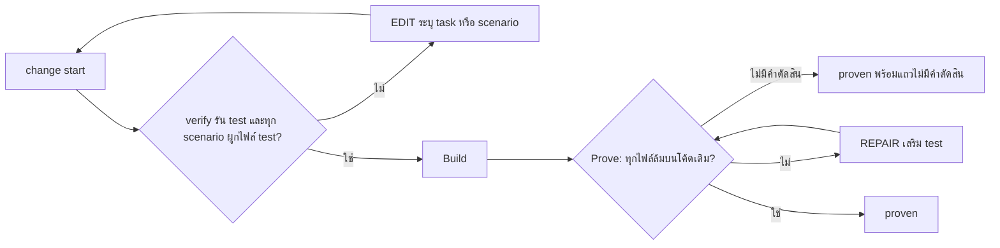

# Design

## สถานะปัจจุบัน

- `semantic-draft.mjs` ตรวจว่า task มี outcome, verify, covers แต่ไม่ตรวจว่า verify รัน test
- claim ของ scenario ผูกกับ task ผ่าน covers ระดับ requirement และ provider test ที่ derive ใช้ `claims: declared`
- `test-discrimination.mjs` รันไฟล์ test ที่เปลี่ยนรวมกันหนึ่งครั้งต่อ repository และผล no-test-provider, unavailable, timed-out กลายเป็น not-applicable

## Work type

feature

## เส้นทางผู้ใช้

เส้นทางของ agent ตั้งแต่ change start ถึง proven รวมทางที่ถูกส่งกลับแก้



## พฤติกรรมขณะทำงาน

1. change start/revise/amend: ตรวจรูปแบบ verify ของ task ที่มี path product แล้วตรวจว่าทุก scenario ผูกไฟล์ test; issue ทั้งหมดอยู่ใน EDIT batch เดียวกับ issue อื่นของ start
2. compile บันทึกแผนที่ scenario → ไฟล์ test (และธง regression) ใน runtime state
3. Prove: ต่อ repository ที่โค้ด product เปลี่ยน รันไฟล์ test ที่เปลี่ยนทีละไฟล์บนโค้ดเดิมเมื่อ runner รับไฟล์ได้; ไฟล์ที่ผ่านบนโค้ดเดิมซึ่งผูกกับ scenario ที่ไม่ใช่ regression เป็น finding; ไฟล์ที่ผูกไว้แต่ไม่มีเป็น finding
4. ผลไม่มีคำตัดสินถูกเก็บไว้กับ change และแสดงใน outcome ของ advance และรายงาน Land; ไม่มี test provider เป็น REPAIR

## Decisions

- **Decision ID:** DEC-001
  - **Status:** accepted
  - **Decision:** ทำครบสามทางแก้ใน change เดียว และคงพฤติกรรมไฟล์นอก paths
  - **Why:** ผู้ใช้ตอบ ทำครบสามข้อ
  - **Rejected:** none
  - **Consequences:** change ใหญ่ขึ้นแต่ปิดทุกช่องที่พบในรอบเดียว
  - **Decided by:** user
- **Decision ID:** DEC-002
  - **Status:** accepted
  - **Decision:** ผูกและตัดสินระดับไฟล์ test ไม่ใช่ test case
  - **Why:** runner หลักรับไฟล์ได้ ส่วนการแยก test case ต้อง parse ผลเฉพาะ runner
  - **Rejected:** none
  - **Consequences:** test case ที่ไม่ทดสอบอะไรยังซ่อนในไฟล์เดียวกับ test ที่ล้มบนโค้ดเดิมได้
  - **Decided by:** agent
- **Decision ID:** DEC-003
  - **Status:** accepted
  - **Decision:** scenario ที่ประกาศ regression: true ยกเว้นจากการต้องล้มบนโค้ดเดิม
  - **Why:** test ที่คุ้มกันพฤติกรรมเดิมผ่านบนโค้ดเดิมโดยชอบ
  - **Rejected:** none
  - **Consequences:** ผู้ approve เห็นธง regression ใน spec และตัดสินได้ว่าสมเหตุสมผล
  - **Decided by:** agent

## ตารางความล้มเหลว

| Failure | User sees | Recovery | Covers |
|---|---|---|---|
| scenario ไม่มีไฟล์ test | ได้ EDIT ที่ระบุชื่อ scenario และ requirement | agent เพิ่มไฟล์ test แล้วรัน change start ซ้ำ | scenario-test-binding |
| amendment เพิ่ม scenario ที่ไม่ผูก | change amend ส่ง EDIT ที่ระบุ scenario นั้น | agent เพิ่มไฟล์ test ใน amendment แล้วรันซ้ำ | scenario-test-binding |
| test ที่ไม่ทดสอบซ่อนหลังไฟล์อื่น | ได้ REPAIR tests-not-discriminating ที่ระบุ b.test.mjs และ scenario ของมัน | agent เสริม test ใน b.test.mjs แล้ว resume gate เดิม | per-file-discrimination |
| ไฟล์ test ที่ผูกไว้ไม่มีอยู่ | ได้ REPAIR ที่ระบุ scenario และ path tests/config.test.mjs | agent สร้าง test นั้นแล้ว resume | per-file-discrimination |
| verify ไม่มีผล | ได้ EDIT ที่ระบุ task และบอกว่า verify ต้องรัน test | agent แก้ verify แล้วรันซ้ำ | verify-runs-tests |
| verify เป็น lint | ได้ EDIT ที่ระบุ task นั้น | No separate step; the outcome is the handling | verify-runs-tests |
| amendment แก้ verify เป็น echo | change amend ส่ง EDIT ที่ระบุ task นั้น | No separate step; the outcome is the handling | verify-runs-tests |
| ไม่มี test provider | ได้ REPAIR ที่ระบุ repository และบอกให้เพิ่ม capability test | agent เพิ่ม test evidence ผ่าน amendment แล้ว resume | discrimination-no-verdict-visible |

## ความเข้ากันได้และการปล่อย

Change ที่ไม่มีแผนที่บันทึกไว้ (สร้างก่อนอัปเกรด) ใช้การตัดสินรวมต่อ repository แบบเดิม draft v4 และ v5 ยังอ่านได้ ฟิลด์ `regression` ของ scenario เป็นฟิลด์เสริม

## กลยุทธ์การทดสอบ

แต่ละ requirement มีไฟล์ test ของตัวเองตาม test map ใช้ fixture repository ชั่วคราวและ runner `node --test` จริงสำหรับ discrimination

## แผนที่ไฟล์

| Tasks | Paths |
|---|---|
| T001 | `.claude/harness/runtime/workflow/validation/verify-shape.mjs` (add), `.claude/harness/tests/verify-shape.test.mjs` (add) |
| T001; T002 | `.claude/harness/runtime/workflow/change-lifecycle.mjs`, `.claude/harness/runtime/workflow/semantic-amendment.mjs` |
| T002 | `.claude/harness/runtime/workflow/validation/scenario-test-binding.mjs` (add), `.claude/harness/runtime/workflow/semantic-draft.mjs`, `.claude/harness/tests/scenario-test-binding.test.mjs` (add) |
| T003; T004 | `.claude/harness/runtime/evidence/test-discrimination.mjs`, `.claude/harness/runtime/evidence/proof-execution-runtime.mjs` |
| T003 | `.claude/harness/foundation.mjs`, `.claude/harness/tests/test-discrimination.test.mjs` |
| T004 | `.claude/harness/runtime/workflow/land-runtime.mjs`, `.claude/harness/tests/test-discrimination-verdict.test.mjs` (add) |
| T005 | `WORKFLOW.md`, `.claude/harness/EVIDENCE.md`, `CHANGELOG.md` |

`+` add · `~` change · `-` remove

```text
.
├── .claude/
│   └── harness/
│       ├── ~ EVIDENCE.md
│       ├── ~ foundation.mjs
│       ├── runtime/
│       │   ├── evidence/
│       │   │   ├── ~ proof-execution-runtime.mjs
│       │   │   └── ~ test-discrimination.mjs
│       │   └── workflow/
│       │       ├── ~ change-lifecycle.mjs
│       │       ├── ~ land-runtime.mjs
│       │       ├── ~ semantic-amendment.mjs
│       │       ├── ~ semantic-draft.mjs
│       │       └── validation/
│       │           ├── + scenario-test-binding.mjs
│       │           └── + verify-shape.mjs
│       └── tests/
│           ├── + scenario-test-binding.test.mjs
│           ├── + test-discrimination-verdict.test.mjs
│           ├── ~ test-discrimination.test.mjs
│           └── + verify-shape.test.mjs
├── ~ CHANGELOG.md
└── ~ WORKFLOW.md
```

## แผนที่ test

| Scenario | Level | File | Task |
|---|---|---|---|
| scenario-test-binding-bound | unit | .claude/harness/tests/scenario-test-binding.test.mjs | scenario-binding |
| scenario-test-binding-unbound | unit | .claude/harness/tests/scenario-test-binding.test.mjs | scenario-binding |
| scenario-test-binding-neutral | unit | .claude/harness/tests/scenario-test-binding.test.mjs | scenario-binding |
| scenario-test-binding-amend-unbound | unit | .claude/harness/tests/scenario-test-binding.test.mjs | scenario-binding |
| per-file-discrimination-hidden | integration | .claude/harness/tests/test-discrimination.test.mjs | per-file-discrimination |
| per-file-discrimination-all-fail | integration | .claude/harness/tests/test-discrimination.test.mjs | per-file-discrimination |
| per-file-discrimination-regression | integration | .claude/harness/tests/test-discrimination.test.mjs | per-file-discrimination |
| per-file-discrimination-missing-file | integration | .claude/harness/tests/test-discrimination.test.mjs | per-file-discrimination |
| per-file-discrimination-unscoped | integration | .claude/harness/tests/test-discrimination.test.mjs | per-file-discrimination |
| per-file-discrimination-cached | integration | .claude/harness/tests/test-discrimination.test.mjs | per-file-discrimination |
| verify-runs-tests-noop | unit | .claude/harness/tests/verify-shape.test.mjs | verify-shape |
| verify-runs-tests-lint-only | unit | .claude/harness/tests/verify-shape.test.mjs | verify-shape |
| verify-runs-tests-test-file | unit | .claude/harness/tests/verify-shape.test.mjs | verify-shape |
| verify-runs-tests-runner | unit | .claude/harness/tests/verify-shape.test.mjs | verify-shape |
| verify-runs-tests-docs-task | unit | .claude/harness/tests/verify-shape.test.mjs | verify-shape |
| verify-runs-tests-amend-noop | unit | .claude/harness/tests/verify-shape.test.mjs | verify-shape |
| discrimination-no-verdict-visible-no-provider | integration | .claude/harness/tests/test-discrimination-verdict.test.mjs | no-verdict-visible |
| discrimination-no-verdict-visible-timed-out | integration | .claude/harness/tests/test-discrimination-verdict.test.mjs | no-verdict-visible |
| discrimination-no-verdict-visible-unavailable | integration | .claude/harness/tests/test-discrimination-verdict.test.mjs | no-verdict-visible |
| discrimination-no-verdict-visible-verdict | integration | .claude/harness/tests/test-discrimination-verdict.test.mjs | no-verdict-visible |
