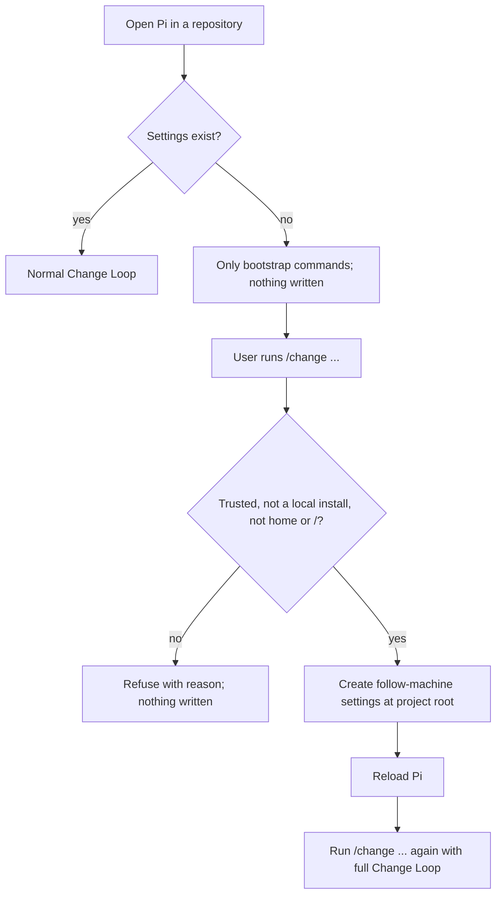

# Design

## Work type

feature

## User flow

Start Change Loop work in a repository that has no Change Loop settings



## Failure matrix

| Failure | User sees | Recovery |
|---|---|---|
| project not trusted | Trust this project before Change Loop creates its settings. | trust the project, then run the command again |
| home directory or filesystem root | Open a project folder before starting Change Loop work. | cd into a project and restart Pi |
| settings creation fails | the installer error; nothing is reloaded | fix the reported cause, then run the command again |
| pending hand-off stale or for another project | nothing runs; the file is removed | run the command again |

## File map

| Tasks | Paths |
|---|---|
| T001 | `.claude/harness/adapters/pi-bootstrap.mjs` (add), `.claude/harness/adapters/pi-shared.ts`, `.claude/harness/tests/pi-shared.test.mjs` |
| T002 | `.claude/harness/README.md`, `CHANGELOG.md` |

`+` add · `~` change · `-` remove

```text
.
├── .claude/
│   └── harness/
│       ├── adapters/
│       │   ├── + pi-bootstrap.mjs
│       │   └── ~ pi-shared.ts
│       ├── ~ README.md
│       └── tests/
│           └── ~ pi-shared.test.mjs
└── ~ CHANGELOG.md
```

## Test map

| Scenario | Level | Check | Task |
|---|---|---|---|
| First /change in a fresh repository; Stale or foreign hand-off is ignored; Untrusted folder; Home directory; Local installation; Just opened | task check | `FOUNDATION_UPDATE_CHECK=0 node --test .claude/harness/tests/pi-shared.test.mjs` | T001 |
| Documented | task check | `grep -q 'first' .claude/harness/README.md && grep -q 'first' CHANGELOG.md && bash .claude/tests/docs/run-doc-consistency.sh` | T002 |
