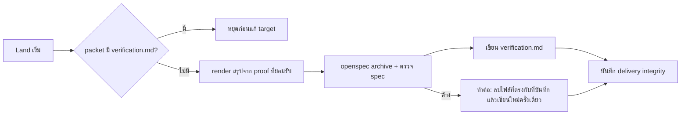

# Design

## ภาพรวม

ต่อยอดกลไก archive appendix เดิมใน `apply-runtime.mjs`: `prepareArchiveAppendix` render ข้อความ verification จาก proof ที่ Land ยอมรับ (`proofPath(id)`) และ receipt แต่ละตัว เก็บไว้ใน `state.land.archiveAppendix.verification` ก่อน `openspec archive`; `appendArchiveAppendix` เขียน `verification.md` และ `stripArchiveAppendix` ลบไฟล์เมื่อเนื้อหาตรงกับที่บันทึก ทุกทางที่ทำ Land ต่อ (resume, recover interrupted archive) เรียกคู่นี้อยู่แล้ว จึงเขียนครั้งเดียว

## Work type

feature

## เส้นทางผู้ใช้

ลำดับที่ Land สร้าง verification.md รวมทางล้มเหลวและการทำต่อ



## พฤติกรรมขณะทำงาน

- Renderer `renderVerificationRecord` อยู่ใน `process-fields.mjs` ข้าง `renderReviewRecord` ใช้ `table`/`cell` เดิมเพื่อ escape `|` และขึ้นบรรทัด
- แถว provider: claims, status, observed, command, durationMs, sha256 จาก proof; receipt ที่อ่านไม่ได้ได้ status `unavailable`
- ไม่ใส่ `log`, `environment`, `artifacts` หรือ path ของ receipt
- Review: มี attempt ที่ completed → ชี้ไป Appendix ใน `proposal.md`; ไม่มี → บอกว่าไม่มี review record
- `archive()` ตรวจหลัง `landCheck` และก่อน `snapshotArchiveEvidence`: ถ้า root packet หรือ sandbox packet มี `verification.md` → `fail` ก่อนแก้ target
- ตอนเขียน ถ้าไฟล์ยังอยู่หลัง strip (เนื้อหาไม่ตรง) → `fail` ไม่เขียนทับ

## Decisions

- **Decision ID:** DEC-D-SHAPE
  - **Status:** accepted
  - **Context:** รูปแบบหลักฐาน test ใน archive
  - **Decision:** ไฟล์ verification.md แยก
  - **Why:** No alternative was open; recorded as settled
  - **Rejected:** none
  - **Consequences:** Not stated in the draft
  - **Decided by:** user

## ตารางความล้มเหลว

| Failure | User sees | Recovery | Covers |
|---|---|---|---|
| Receipt อ่านไม่ได้ | แถวของ provider นั้นมี status unavailable และ sha256 จาก proof | Land ทำต่อจนจบ เพราะ receipt ผ่านการ audit ก่อน Land แล้ว ไฟล์สรุปบอกตรงๆ ว่าอ่านไม่ได้ | verification-record-written |
| ไฟล์ถูกแก้ระหว่างค้าง | Land หยุดและบอกว่า verification.md ต่างจากที่บันทึก | ไฟล์ที่ถูกแก้ยังอยู่ ผู้ใช้เก็บสำเนาแล้วลบไฟล์ แล้วทำ Land ต่อ | verification-record-resume |
| Packet มีไฟล์ชื่อซ้ำ | Land หยุดพร้อมข้อความที่บอกชื่อไฟล์ และ change ยังไม่ archive | ย้ายเนื้อหาไปไฟล์อื่นผ่าน change revise แล้วทำ Land ต่อ | verification-name-reserved |

## แผนที่ไฟล์

| Tasks | Paths |
|---|---|
| T001; T003 | `.claude/harness/runtime/workflow/apply-runtime.mjs` |
| T001 | `.claude/harness/runtime/workflow/validation/process-fields.mjs`, `.claude/harness/tests/archive-verification-record.test.mjs` (add), `.claude/harness/tests/archive-appendices.test.mjs` |
| T002 | `.claude/harness/lifecycle/land.md`, `website/docs/src/content/docs/loop/change.md`, `website/docs/src/content/docs/th/loop/change.md` |

`+` add · `~` change · `-` remove

```text
.
├── .claude/
│   └── harness/
│       ├── lifecycle/
│       │   └── ~ land.md
│       ├── runtime/
│       │   └── workflow/
│       │       ├── ~ apply-runtime.mjs
│       │       └── validation/
│       │           └── ~ process-fields.mjs
│       └── tests/
│           ├── ~ archive-appendices.test.mjs
│           └── + archive-verification-record.test.mjs
└── website/
    └── docs/
        └── src/
            └── content/
                └── docs/
                    ├── loop/
                    │   └── ~ change.md
                    └── th/
                        └── loop/
                            └── ~ change.md
```

## แผนที่ test

| Scenario | Level | Check | Task |
|---|---|---|---|
| Proof ผ่านมี receipt test; Receipt อ่านไม่ได้; ไม่มีข้อมูลเครื่อง; Review ไม่บังคับ; Review มีผล; Packet ภาษาไทย; Packet ที่ active ไม่มีไฟล์; Delivery integrity ครอบไฟล์; ทำต่อหลังเขียนไฟล์; ไฟล์ถูกแก้ระหว่างค้าง; Packet มีไฟล์ชื่อซ้ำ | task check | `node --test .claude/harness/tests/archive-verification-record.test.mjs .claude/harness/tests/archive-appendices.test.mjs` | T001 |
| Proof ผ่านมี receipt test; Receipt อ่านไม่ได้; ไม่มีข้อมูลเครื่อง; Review ไม่บังคับ; Review มีผล; Packet ภาษาไทย; Packet ที่ active ไม่มีไฟล์; Delivery integrity ครอบไฟล์ | task check | `bash .claude/tests/docs/run-doc-consistency.sh` | T002 |
| Proof ผ่านมี receipt test; Receipt อ่านไม่ได้; ไม่มีข้อมูลเครื่อง; Review ไม่บังคับ; Review มีผล; Packet ภาษาไทย; Packet ที่ active ไม่มีไฟล์; Delivery integrity ครอบไฟล์; ทำต่อหลังเขียนไฟล์; ไฟล์ถูกแก้ระหว่างค้าง; Packet มีไฟล์ชื่อซ้ำ | task check | `env -u CLAUDE_FOUNDATION_PROJECT -u CLAUDE_PROJECT_DIR bash .claude/tests/run-all.sh` | T003 |
