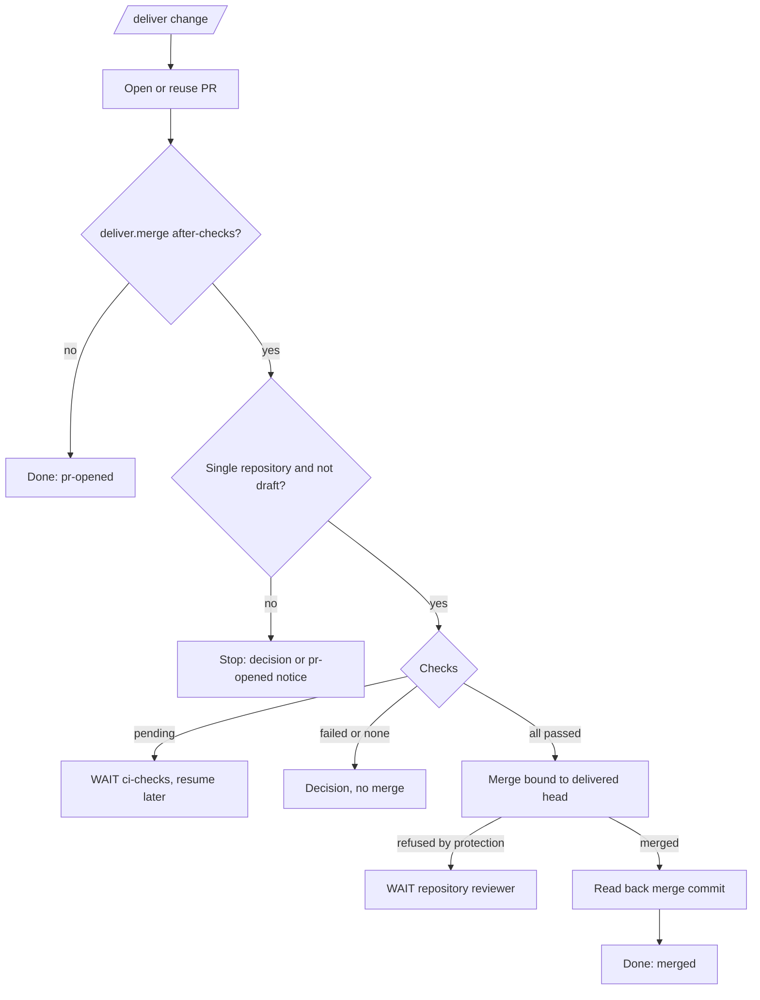

# Design

## Work type

feature

## User flow

How one /deliver moves from an open pull request to a merge, including every stop that does not merge.



## Failure matrix

| Failure | User sees | Recovery | Covers |
|---|---|---|---|
| Unknown merge policy is refused | Deliver returns a delivery-policy wait naming deliver.merge before any merge request | No separate step; the outcome is the handling | merge-is-opt-in |
| Failing checks stop | it returns a decision naming the failed checks and sends no merge request | No separate step; the outcome is the handling | merge-stops-safely |
| No reported checks stop | it returns a decision and sends no merge request | No separate step; the outcome is the handling | merge-stops-safely |
| Branch protection refusal waits | it returns a WAIT owned by the repository reviewer with the provider reason and never retries with an admin override | No separate step; the outcome is the handling | merge-stops-safely |
| Draft pull request is not merged | it returns a decision and sends no merge request | No separate step; the outcome is the handling | merge-stops-safely |

## File map

| Tasks | Paths |
|---|---|
| T001 | `.claude/harness/runtime/workflow/delivery-merge.mjs` (add), `.claude/harness/runtime/workflow/pull-request-runtime.mjs`, `.claude/harness/tests/pull-request-runtime.test.mjs` |
| T002 | `.claude/commands/deliver.md`, `README.md`, `README.th.md`, `website/docs/src/content/docs/cli.md`, `website/docs/src/content/docs/th/cli.md`, `website/docs/src/content/docs/foundation-config.md`, `website/docs/src/content/docs/th/foundation-config.md`, `CHANGELOG.md` |

`+` add · `~` change · `-` remove

```text
.
├── .claude/
│   ├── commands/
│   │   └── ~ deliver.md
│   └── harness/
│       ├── runtime/
│       │   └── workflow/
│       │       ├── + delivery-merge.mjs
│       │       └── ~ pull-request-runtime.mjs
│       └── tests/
│           └── ~ pull-request-runtime.test.mjs
├── ~ CHANGELOG.md
├── ~ README.md
├── ~ README.th.md
└── website/
    └── docs/
        └── src/
            └── content/
                └── docs/
                    ├── ~ cli.md
                    ├── ~ foundation-config.md
                    └── th/
                        ├── ~ cli.md
                        └── ~ foundation-config.md
```

## Test map

| Scenario | Level | Check | Task |
|---|---|---|---|
| No merge policy keeps the PR open; Unknown merge policy is refused; Green checks merge the pull request; Repeated Deliver does not merge twice; Pending checks wait; Failing checks stop; No reported checks stop; Branch protection refusal waits; Draft pull request is not merged; Multi-repository delivery is not merged | task check | `node --test .claude/harness/tests/pull-request-runtime.test.mjs` | T001 |
| No merge policy keeps the PR open; Unknown merge policy is refused; Green checks merge the pull request; Repeated Deliver does not merge twice | task check | `grep -q 'deliver.merge' .claude/commands/deliver.md && grep -q 'deliver.merge' website/docs/src/content/docs/foundation-config.md && grep -q 'deliver.merge' website/docs/src/content/docs/th/foundation-config.md && grep -q 'deliver.merge' CHANGELOG.md && bash .claude/tests/docs/run-doc-consistency.sh` | T002 |
