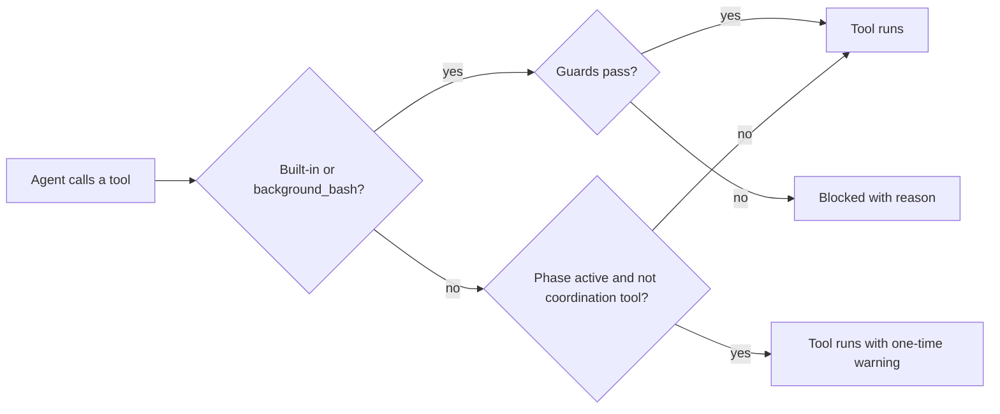

# Design

## Work type

feature

## เส้นทางผู้ใช้

เส้นทางของ tool call ใน Pi ผ่าน guard รวมถึงทางที่ถูกปฏิเสธ



## Decisions

- **Decision ID:** DEC-001
  - **Status:** accepted
  - **Decision:** tool ที่ไม่รู้จักได้คำเตือน ไม่ถูกบล็อก
  - **Why:** ผู้ใช้เลือกแนวทางนี้เพื่อไม่ให้ MCP และ worker ใช้ไม่ได้ ด่าน Land ยังตรวจขั้นสุดท้าย
  - **Rejected:** none
  - **Consequences:** tool ที่ไม่รู้จักยังเขียนหรืออ่านไฟล์ลับได้ แต่เอเจนต์ถูกเตือน
- **Decision ID:** DEC-002
  - **Status:** accepted
  - **Decision:** ตาราง capabilities ของ Pi คง coverage: partial แต่ sessionDigest เป็น live
  - **Why:** tool ที่ไม่รู้จักยังอยู่นอกขอบเขต guard จึงอ้าง full ไม่ได้อย่างซื่อตรง
  - **Rejected:** none
  - **Consequences:** doc consistency check และเอกสารต้องเปลี่ยนเฉพาะ sessionDigest
- **Decision ID:** DEC-003
  - **Status:** accepted
  - **Decision:** ตัวเตือน /dev ของ Pi เป็นคำเตือนอย่างเดียว ไม่บังคับให้ทำต่อ
  - **Why:** ตรงกับพฤติกรรม Claude Code ที่เป็น advisory เพื่อไม่ให้วนรอบ
  - **Rejected:** none
  - **Consequences:** /dev ที่หยุดกลางทางยังหยุดได้ แต่ถูกบันทึกเป็น incomplete

## ตารางความล้มเหลว

| Failure | User sees | Recovery | Covers |
|---|---|---|---|
| อ่านไฟล์ลับถูกกัน | คำสั่งถูกเขียนใหม่ให้อ่านสำเนาที่ปิดค่าลับ หรือถูกปฏิเสธ และค่าลับเดิมไม่ปรากฏ | No separate step; the outcome is the handling | background-bash-guarded |
| Land โดยไม่ได้รับสิทธิ์ถูกปฏิเสธ | การเรียกถูกบล็อกพร้อมข้อความว่าต้องได้สิทธิ์ Land | No separate step; the outcome is the handling | background-bash-guarded |
| authority run แบบ background ถูกปฏิเสธ | การเรียกถูกบล็อกพร้อมบอกให้รันใน bash แบบ foreground | No separate step; the outcome is the handling | background-bash-guarded |
| เขียนนอก workspace ตอน Build ถูกกัน | phase guard ปฏิเสธหรือแนบคำเตือนเหมือนกับ bash | No separate step; the outcome is the handling | background-bash-guarded |
| authority run แบบ detach ถูกปฏิเสธ | การเรียกถูกบล็อกพร้อมบอกให้รันแบบ foreground | No separate step; the outcome is the handling | detached-authority-bash |
| digest ล้มเหลวไม่บล็อก | Change Loop ยังพร้อมใช้และไม่มีข้อความ digest | No separate step; the outcome is the handling | session-digest |
| หยุดก่อน proof ผ่านได้คำเตือน | ผู้ใช้ได้คำเตือนที่ระบุ proof-not-passing และทางไปต่อ | No separate step; the outcome is the handling | dev-terminal-warning |

## แผนที่ไฟล์

| Tasks | Paths |
|---|---|
| T001; T002 | `.claude/harness/adapters/pi-extension.mjs`, `.claude/harness/tests/pi-extension.test.mjs` |
| T001 | `.claude/hooks/dev-terminal-guard.mjs` |
| T002 | `.claude/harness/adapters/host-capabilities.json`, `.claude/tests/docs/run-doc-consistency.sh`, `.claude/hooks/README.md`, `.claude/harness/README.md`, `website/docs/src/content/docs/install.md`, `website/docs/src/content/docs/th/install.md`, `CHANGELOG.md` |

`+` add · `~` change · `-` remove

```text
.
├── .claude/
│   ├── harness/
│   │   ├── adapters/
│   │   │   ├── ~ host-capabilities.json
│   │   │   └── ~ pi-extension.mjs
│   │   ├── ~ README.md
│   │   └── tests/
│   │       └── ~ pi-extension.test.mjs
│   ├── hooks/
│   │   ├── ~ dev-terminal-guard.mjs
│   │   └── ~ README.md
│   └── tests/
│       └── docs/
│           └── ~ run-doc-consistency.sh
├── ~ CHANGELOG.md
└── website/
    └── docs/
        └── src/
            └── content/
                └── docs/
                    ├── ~ install.md
                    └── th/
                        └── ~ install.md
```

## แผนที่ test

| Scenario | Level | Check | Task |
|---|---|---|---|
| อ่านไฟล์ลับถูกกัน; Land โดยไม่ได้รับสิทธิ์ถูกปฏิเสธ; authority run แบบ background ถูกปฏิเสธ; เขียนนอก workspace ตอน Build ถูกกัน; Build เริ่มใน workspace; guard ใช้ไม่ได้ปิดตาย; authority run แบบ detach ถูกปฏิเสธ; authority run ปกติผ่าน; MCP ระหว่าง Build ได้คำเตือน; นอกงานไม่เตือน; tool ประสานงานไม่เตือน; เริ่ม session ได้ digest; หลัง compact ได้ digest ใหม่; digest ล้มเหลวไม่บล็อก; หยุดก่อน proof ผ่านได้คำเตือน; คำสั่งอื่นไม่ถูกประเมิน; plan-only ไม่เตือน | task check | `FOUNDATION_UPDATE_CHECK=0 node --test .claude/harness/tests/pi-extension.test.mjs` | T001 |
| ตารางตรงกับเอกสาร; prompt ไม่อ้างเกินจริง | task check | `bash .claude/tests/docs/run-doc-consistency.sh && FOUNDATION_UPDATE_CHECK=0 node --test .claude/harness/tests/pi-extension.test.mjs` | T002 |
