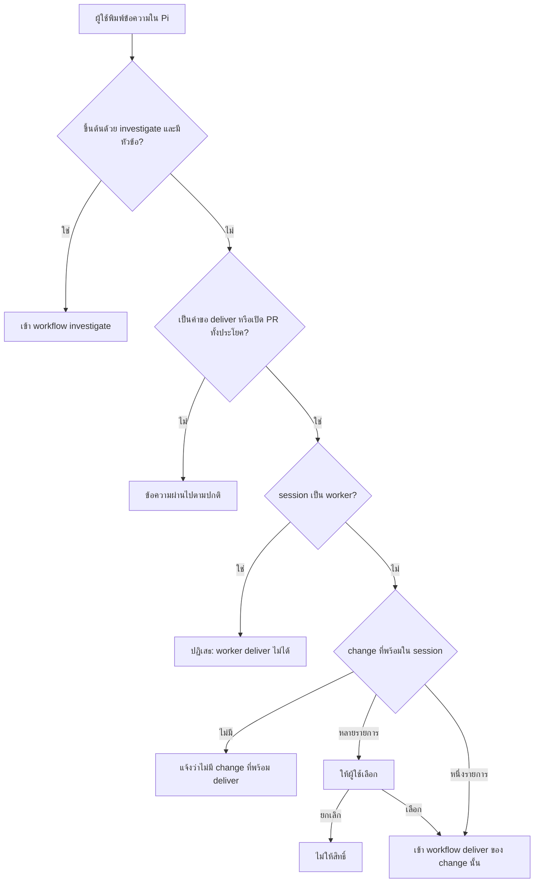

# Design

## Work type

feature

## เส้นทางผู้ใช้

เส้นทางของผู้ใช้เมื่อพิมพ์คำขอ investigate หรือ deliver เป็นภาษาธรรมดาใน Pi



## ตารางความล้มเหลว

| Failure | User sees | Recovery | Covers |
|---|---|---|---|
| ข้อความที่ไม่ได้มาจากผู้ใช้ | ข้อความไม่ถูกแทน | No separate step; the outcome is the handling | natural-investigate-routing |
| คำถามหรือคำปฏิเสธไม่ใช่คำสั่ง | ข้อความไม่ถูกแทนและ deliver advance ยังถูกบล็อก | No separate step; the outcome is the handling | natural-deliver-consent |
| Worker ส่งต่อไม่ได้ | Pi ปฏิเสธด้วยข้อความว่า worker deliver ไม่ได้ | No separate step; the outcome is the handling | natural-deliver-consent |

## แผนที่ไฟล์

| Tasks | Paths |
|---|---|
| T001; T003 | `.claude/harness/adapters/pi-extension.mjs` |
| T001 | `.claude/harness/runtime/core/pi-land-context.mjs`, `.claude/harness/tests/pi-extension.test.mjs` |
| T002 | `WORKFLOW.md`, `.claude/harness/README.md`, `CHANGELOG.md` |

`+` add · `~` change · `-` remove

```text
.
├── .claude/
│   └── harness/
│       ├── adapters/
│       │   └── ~ pi-extension.mjs
│       ├── ~ README.md
│       ├── runtime/
│       │   └── core/
│       │       └── ~ pi-land-context.mjs
│       └── tests/
│           └── ~ pi-extension.test.mjs
├── ~ CHANGELOG.md
└── ~ WORKFLOW.md
```

## แผนที่ test

| Scenario | Level | Check | Task |
|---|---|---|---|
| Investigate ภาษาธรรมดาเข้า workflow; ไม่ใช่คำขอ investigate; ข้อความที่ไม่ได้มาจากผู้ใช้; เปิด PR ให้เลย เลือก change ของ session; คำถามหรือคำปฏิเสธไม่ใช่คำสั่ง; ไม่มี change ใน session; Worker ส่งต่อไม่ได้; /deliver ไม่ใส่ change-id | task check | `node --test .claude/harness/tests/pi-extension.test.mjs` | T001 |
| เอกสารครบ | task check | `bash .claude/tests/docs/run-doc-consistency.sh` | T002 |
| Investigate ภาษาธรรมดาเข้า workflow; ไม่ใช่คำขอ investigate; ข้อความที่ไม่ได้มาจากผู้ใช้; เปิด PR ให้เลย เลือก change ของ session; คำถามหรือคำปฏิเสธไม่ใช่คำสั่ง; ไม่มี change ใน session; Worker ส่งต่อไม่ได้; /deliver ไม่ใส่ change-id | task check | `env -u CLAUDE_FOUNDATION_PROJECT -u CLAUDE_PROJECT_DIR bash .claude/tests/run-all.sh` | T003 |
