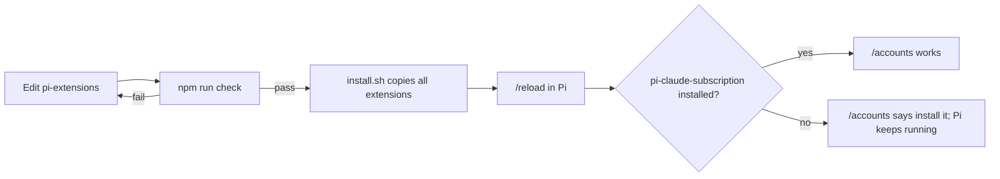

# Design

## Work type

feature

## เส้นทางผู้ใช้

Maintainer edits, checks and installs the imported extensions, including a missing subscription package



## Decisions

- **Decision ID:** DEC-001
  - **Status:** accepted
  - **Decision:** commit web/vendor (mermaid, three, markdown) เข้า repo
  - **Why:** เป็น asset ที่ web UI เสิร์ฟตอนรันจริง และ three.js ไม่ได้สร้างจาก build script
  - **Rejected:** none
  - **Consequences:** Not stated in the draft
- **Decision ID:** DEC-002
  - **Status:** accepted
  - **Decision:** เพิ่ม team-webui/index.ts ที่ re-export จาก extension.ts
  - **Why:** ทุก extension ในแพ็กเกจใช้ index.ts เป็นจุดเข้า
  - **Rejected:** none
  - **Consequences:** Not stated in the draft
- **Decision ID:** DEC-003
  - **Status:** accepted
  - **Decision:** claude-accounts import pi-claude-subscription แบบ dynamic จาก agent dir
  - **Why:** path สัมพัทธ์เดิมใช้ได้เฉพาะตอนติดตั้งใน ~/.pi/agent/extensions ทำให้ typecheck, docs และเทสต์ใน repo ใช้ไม่ได้
  - **Rejected:** none
  - **Consequences:** Not stated in the draft

## ตารางความล้มเหลว

| Failure | User sees | Recovery | Covers |
|---|---|---|---|
| เรียก API ที่ไม่มีอยู่ | tsc รายงาน error | No separate step; the outcome is the handling | typecheck |
| เทสต์ reload ครบโมดูล | ทุกโมดูลที่ task-store import ถูกคัดลอกและเทสต์ผ่าน | No separate step; the outcome is the handling | team-webui-package |
| ไม่มีแพ็กเกจ subscription | Pi โหลดสำเร็จ และ /accounts แจ้งให้ติดตั้งแพ็กเกจโดยไม่ลงทะเบียน provider | No separate step; the outcome is the handling | claude-accounts-package |

## แผนที่ไฟล์

| Tasks | Paths |
|---|---|
| T001; T003 | `pi-extensions/team-webui/` (add) |
| T002; T003 | `pi-extensions/claude-accounts/` (add) |
| T003 | `pi-extensions/package.json`, `pi-extensions/package-lock.json`, `pi-extensions/tsconfig.json`, `pi-extensions/install.sh`, `pi-extensions/test.sh`, `pi-extensions/scripts/`, `pi-extensions/README.md`, `pi-extensions/CHANGELOG.md`, `pi-extensions/docs/`, `pi-extensions/agent-team/`, `pi-extensions/ask-user/`, `pi-extensions/background-bash/`, `pi-extensions/nine-router/`, `pi-extensions/session-title/` |

`+` add · `~` change · `-` remove

```text
.
└── pi-extensions/
    ├── ~ agent-team/
    ├── ~ ask-user/
    ├── ~ background-bash/
    ├── ~ CHANGELOG.md
    ├── + claude-accounts/
    ├── ~ docs/
    ├── ~ install.sh
    ├── ~ nine-router/
    ├── ~ package-lock.json
    ├── ~ package.json
    ├── ~ README.md
    ├── ~ scripts/
    ├── ~ session-title/
    ├── + team-webui/
    ├── ~ test.sh
    └── ~ tsconfig.json
```

## แผนที่ test

| Scenario | Level | Check | Task |
|---|---|---|---|
| ลงทะเบียนครบ; background jobs จาก extension ข้างกัน; เทสต์ reload ครบโมดูล; Extensions are present without personal paths; Generated reports stay out | task check | `cd pi-extensions && node --test team-webui/test/*.test.mjs` | T001 |
| ใช้แพ็กเกจที่ติดตั้งไว้; ไม่มีแพ็กเกจ subscription; Extensions are present without personal paths; Generated reports stay out | task check | `cd pi-extensions && node --test claude-accounts/*.test.cjs` | T002 |
| โค้ดปัจจุบันผ่าน typecheck; เรียก API ที่ไม่มีอยู่; ทุก extension อยู่ในขอบเขต typecheck; สร้าง renderer; Extensions are present without personal paths; Generated reports stay out; ลงทะเบียนครบ; background jobs จาก extension ข้างกัน; เทสต์ reload ครบโมดูล | task check | `npm --prefix pi-extensions run check` | T003 |
