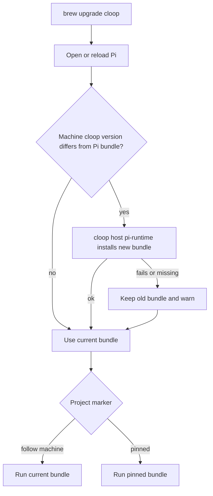

# Design

## Work type

feature

## User flow

Keep Pi on the machine's Change Loop version without manual reinstalls



## Failure matrix

| Failure | User sees | Recovery | Covers |
|---|---|---|---|
| Broken CLI keeps the old bundle | Pi keeps the existing current bundle and the loader reports a warning | No separate step; the outcome is the handling | loader-syncs |

## File map

| Tasks | Paths |
|---|---|
| T001 | `cli.sh`, `.claude/harness/adapters/pi-runtime.mjs` (add), `.claude/harness/adapters/pi-installation.mjs`, `.claude/harness/adapters/pi-shared.ts`, `.claude/harness/runtime/core/project-installation.mjs`, `.claude/harness/tests/pi-shared.test.mjs` |
| T002 | `.claude/harness/README.md`, `CHANGELOG.md` |

`+` add · `~` change · `-` remove

```text
.
├── .claude/
│   └── harness/
│       ├── adapters/
│       │   ├── ~ pi-installation.mjs
│       │   ├── + pi-runtime.mjs
│       │   └── ~ pi-shared.ts
│       ├── ~ README.md
│       ├── runtime/
│       │   └── core/
│       │       └── ~ project-installation.mjs
│       └── tests/
│           └── ~ pi-shared.test.mjs
├── ~ CHANGELOG.md
└── ~ cli.sh
```

## Test map

| Scenario | Level | Check | Task |
|---|---|---|---|
| Endpoint installs and reports; Upgrade is picked up; Same version starts without reinstalling; Broken CLI keeps the old bundle; Follow resolves to current; Pinned stays pinned; Switch modes | task check | `FOUNDATION_UPDATE_CHECK=0 node --test .claude/harness/tests/pi-shared.test.mjs` | T001 |
| Documented | task check | `grep -q 'host pi-runtime' .claude/harness/README.md && grep -q 'follow' CHANGELOG.md && bash .claude/tests/docs/run-doc-consistency.sh` | T002 |
