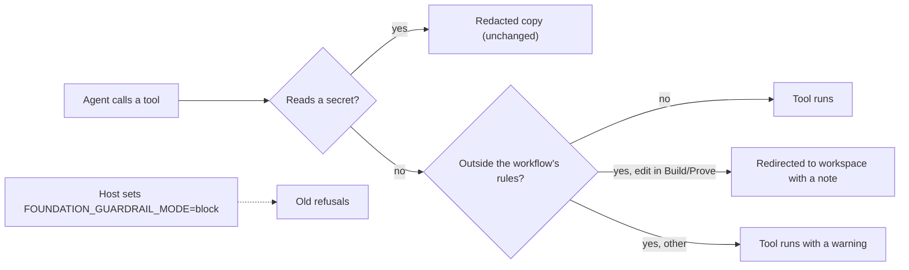

# Design

## Work type

feature

## เส้นทางผู้ใช้

เส้นทางของ tool call ผ่าน guard หลังเปลี่ยนเป็นคำเตือน



## Decisions

- **Decision ID:** DEC-001
  - **Status:** accepted
  - **Decision:** guard เตือนแล้วให้รันต่อในทุกกรณีที่ไม่เกี่ยวกับค่าลับ
  - **Why:** ผู้ใช้เลือก 'เปลี่ยนเป็นคำเตือนทั้งหมด': Change Loop แนะนำ ผู้ใช้และเอเจนต์ตัดสินใจเอง
  - **Rejected:** none
  - **Consequences:** Land, Deliver, commit และ push อาจเกิดโดยไม่มีคำอนุมัติที่พิมพ์ในเทิร์นนั้น; คำเตือนและ audit log บันทึกไว้
- **Decision ID:** DEC-002
  - **Status:** accepted
  - **Decision:** การปิดค่าลับและการปิดตายเมื่อ guard startup ล้มเหลวคงเดิม
  - **Why:** ผู้ใช้เลือก 'คงแบบเดิม' สำหรับค่าลับ
  - **Rejected:** none
  - **Consequences:** Read/Grep/Bash ยังถูกเขียนใหม่ไปอ่านสำเนาที่ปิดค่าลับ
- **Decision ID:** DEC-003
  - **Status:** accepted
  - **Decision:** การแก้ไฟล์ใน main ระหว่าง Build/Prove/Land ถูกย้ายไป workspace พร้อมบอก แทนการปฏิเสธ
  - **Why:** ไม่หยุดงานและทำให้การแก้ไปถึง Land ตามเส้นทางของงาน ตรงกับโหมด auto ของ Claude Code อยู่แล้ว
  - **Rejected:** none
  - **Consequences:** ไฟล์ใน main ไม่เปลี่ยนจนกว่าจะ Land; ผลของ tool บอก path ที่ถูกย้าย
- **Decision ID:** DEC-004
  - **Status:** accepted
  - **Decision:** FOUNDATION_GUARDRAIL_MODE=block และ FOUNDATION_SHELL_GUARD=block ยังให้การปฏิเสธเดิม
  - **Why:** ผู้ที่ต้องการความเข้มงวดเลือกเองได้ ค่าเริ่มต้นไม่บล็อก
  - **Rejected:** none
  - **Consequences:** Pi ใช้ค่าที่ผู้ใช้ตั้งใน environment แทน auto

## ตารางความล้มเหลว

| Failure | User sees | Recovery | Covers |
|---|---|---|---|
| อ่าน .env บน Pi ยังได้สำเนาที่ปิดค่า | ผลไม่มีค่าลับเดิม | No separate step; the outcome is the handling | secrets-still-redacted |

## แผนที่ไฟล์

| Tasks | Paths |
|---|---|
| T001 | `.claude/hooks/phase-mutation-guard.mjs`, `.claude/hooks/shell-route-guard.mjs`, `.claude/hooks/no-detached-authority.mjs`, `.claude/tests/hooks/run-phase-mutation-guard-tests.sh`, `.claude/tests/hooks/shell-route-guard.test.mjs`, `.claude/tests/hooks/run-hook-tests.sh`, `.claude/tests/hooks/no-detached-authority.test.mjs` |
| T002 | `.claude/harness/adapters/pi-extension.mjs`, `.claude/harness/tests/pi-extension.test.mjs` |
| T003 | `pi-extensions/agent-team/roles.ts`, `pi-extensions/agent-team/extension.ts`, `pi-extensions/agent-team/roles.test.cjs`, `pi-extensions/agent-team/README.md`, `pi-extensions/docs/tools.md` |
| T004 | `AGENTS.md`, `CLAUDE.md`, `WORKFLOW.md`, `.claude/hooks/README.md`, `.claude/hooks/phase-mutation-guard.md`, `.claude/harness/README.md`, `.claude/harness/lifecycle/build.md`, `.claude/harness/adapters/host-capabilities.json`, `.claude/tests/docs/run-doc-consistency.sh`, `.claude/tests/docs/advisory-guards-docs.test.mjs` (add), `website/docs/src/content/docs/install.md`, `website/docs/src/content/docs/th/install.md`, `CHANGELOG.md` |

`+` add · `~` change · `-` remove

```text
.
├── .claude/
│   ├── harness/
│   │   ├── adapters/
│   │   │   ├── ~ host-capabilities.json
│   │   │   └── ~ pi-extension.mjs
│   │   ├── lifecycle/
│   │   │   └── ~ build.md
│   │   ├── ~ README.md
│   │   └── tests/
│   │       └── ~ pi-extension.test.mjs
│   ├── hooks/
│   │   ├── ~ no-detached-authority.mjs
│   │   ├── ~ phase-mutation-guard.md
│   │   ├── ~ phase-mutation-guard.mjs
│   │   ├── ~ README.md
│   │   └── ~ shell-route-guard.mjs
│   └── tests/
│       ├── docs/
│       │   ├── + advisory-guards-docs.test.mjs
│       │   └── ~ run-doc-consistency.sh
│       └── hooks/
│           ├── ~ no-detached-authority.test.mjs
│           ├── ~ run-hook-tests.sh
│           ├── ~ run-phase-mutation-guard-tests.sh
│           └── ~ shell-route-guard.test.mjs
├── ~ AGENTS.md
├── ~ CHANGELOG.md
├── ~ CLAUDE.md
├── pi-extensions/
│   ├── agent-team/
│   │   ├── ~ extension.ts
│   │   ├── ~ README.md
│   │   ├── ~ roles.test.cjs
│   │   └── ~ roles.ts
│   └── docs/
│       └── ~ tools.md
├── website/
│   └── docs/
│       └── src/
│           └── content/
│               └── docs/
│                   ├── ~ install.md
│                   └── th/
│                       └── ~ install.md
└── ~ WORKFLOW.md
```

## แผนที่ test

| Scenario | Level | File | Task |
|---|---|---|---|
| advisory-docs | — | .claude/tests/docs/advisory-guards-docs.test.mjs | — |
