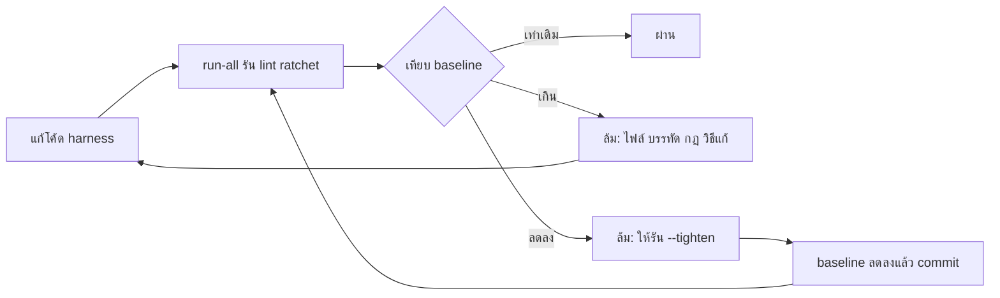

# Design

## Work type

feature

## เส้นทางผู้ใช้

เส้นทางของคนหรือ agent ที่แก้โค้ด harness แล้วรัน gate รวมทางที่ล้ม



## Decisions

- **Decision ID:** DEC-001
  - **Status:** accepted
  - **Decision:** บันทึกจำนวน violation ต่อไฟล์ต่อกฎเป็น baseline ที่ลดได้อย่างเดียว
  - **Why:** เปิด gate ได้ทันทีโดยไม่ต้องแก้ 69k บรรทัดก่อน และของเดิมไม่ถูกนับเป็นตัวอย่างที่ยอมรับเพิ่ม
  - **Rejected:** none
  - **Consequences:** violation ใหม่ในไฟล์ที่มีของเดิมกฎเดียวกันอยู่ จะถูกรายงานเป็นจำนวนเกิน พร้อมรายการทุกบรรทัดของกฎนั้นในไฟล์
- **Decision ID:** DEC-002
  - **Status:** accepted
  - **Decision:** --tighten ลด baseline ได้อย่างเดียว การเพิ่มต้องแก้ไฟล์ baseline เองให้เห็นใน diff
  - **Why:** การยอมรับ violation ใหม่ต้องเป็นการตัดสินใจที่ reviewer เห็น ไม่ใช่คำสั่งอัตโนมัติ
  - **Rejected:** none
  - **Consequences:** คนที่เก็บกวาดของเดิมต้อง commit baseline ที่ลดลงด้วย
- **Decision ID:** DEC-003
  - **Status:** accepted
  - **Decision:** วาง config ที่ scripts/lint/eslint.config.mjs และให้ runner ระบุเอง ไม่วางที่ root
  - **Why:** ไม่เปลี่ยนพฤติกรรมของ collect-complexity ที่ใช้ eslint อยู่ และไม่ปนกับไฟล์ที่ติดตั้งให้ผู้ใช้
  - **Rejected:** none
  - **Consequences:** editor ที่หา config จาก root จะไม่เห็นกฎนี้ ต้องรันผ่าน runner

## ตารางความล้มเหลว

| Failure | User sees | Recovery | Covers |
|---|---|---|---|
| timer เป็นทางรอ | no-timer-wait รายงานพร้อมข้อความให้รอเหตุการณ์หรือเงื่อนไขจริงแทน timer | No separate step; the outcome is the handling | root-cause-rules |
| comment workaround | no-workaround-comment รายงานพร้อมข้อความให้แก้ต้นเหตุหรือแปลงเป็น test/lint | No separate step; the outcome is the handling | root-cause-rules |
| catch ว่าง | no-silent-catch รายงานพร้อมข้อความให้จัดการ, throw ต่อ หรือกรองด้วยเงื่อนไขที่มีชื่อ | No separate step; the outcome is the handling | root-cause-rules |
| disable ไม่มีเหตุผล | no-bare-disable รายงาน | No separate step; the outcome is the handling | root-cause-rules |
| violation ใหม่ | exit ไม่ใช่ 0 และแสดงไฟล์ กฎ จำนวน baseline จำนวนปัจจุบัน บรรทัด และข้อความวิธีแก้ | No separate step; the outcome is the handling | violation-ratchet |
| baseline เสียหรือหาย | exit ไม่ใช่ 0 พร้อมชื่อไฟล์ ไม่ถือว่าผ่าน | No separate step; the outcome is the handling | violation-ratchet |
| composition root โต | exit ไม่ใช่ 0 พร้อมข้อความให้ย้าย logic ไป domain ใต้ runtime/ | No separate step; the outcome is the handling | size-ratchet |
| ไฟล์ใหม่เกินเพดาน | exit ไม่ใช่ 0 พร้อมข้อความให้แยกโมดูล | No separate step; the outcome is the handling | size-ratchet |

## แผนที่ไฟล์

| Tasks | Paths |
|---|---|
| T001; T002 | `scripts/lint/` (add) |
| T001 | `scripts/lint/test/rules.test.mjs` (add) |
| T002 | `scripts/lint/test/ratchet.test.mjs` (add), `quality/baselines/lint-ratchet-v1.json` (add) |
| T003 | `.claude/tests/run-all.sh`, `.claude/tests/affected-suite-selector.mjs`, `.claude/tests/harness/affected-suite-selector.test.mjs`, `.claude/tests/README.md`, `CLAUDE.md`, `quality/README.md` |

`+` add · `~` change · `-` remove

```text
.
├── .claude/
│   └── tests/
│       ├── ~ affected-suite-selector.mjs
│       ├── harness/
│       │   └── ~ affected-suite-selector.test.mjs
│       ├── ~ README.md
│       └── ~ run-all.sh
├── ~ CLAUDE.md
├── quality/
│   ├── baselines/
│   │   └── + lint-ratchet-v1.json
│   └── ~ README.md
└── scripts/
    └── + lint/
        └── test/
            ├── + ratchet.test.mjs
            └── + rules.test.mjs
```

## แผนที่ test

| Scenario | Level | Check | Task |
|---|---|---|---|
| timer เป็นทางรอ; comment workaround; catch ว่าง; disable ไม่มีเหตุผล; โค้ดปกติไม่ถูกรายงาน | task check | `node --test scripts/lint/test/rules.test.mjs` | T001 |
| ไม่มีการเปลี่ยน; violation ใหม่; เก็บกวาดแล้วแต่ baseline ค้าง; tighten ลดได้อย่างเดียว; baseline เสียหรือหาย; composition root โต; ไฟล์ใหม่เกินเพดาน; ไฟล์ใหญ่หดลง | task check | `node --test scripts/lint/test/ratchet.test.mjs` | T002 |
| affected เลือกเสมอ; แก้ test ของกฎ | task check | `node --test .claude/tests/harness/affected-suite-selector.test.mjs` | T003 |
