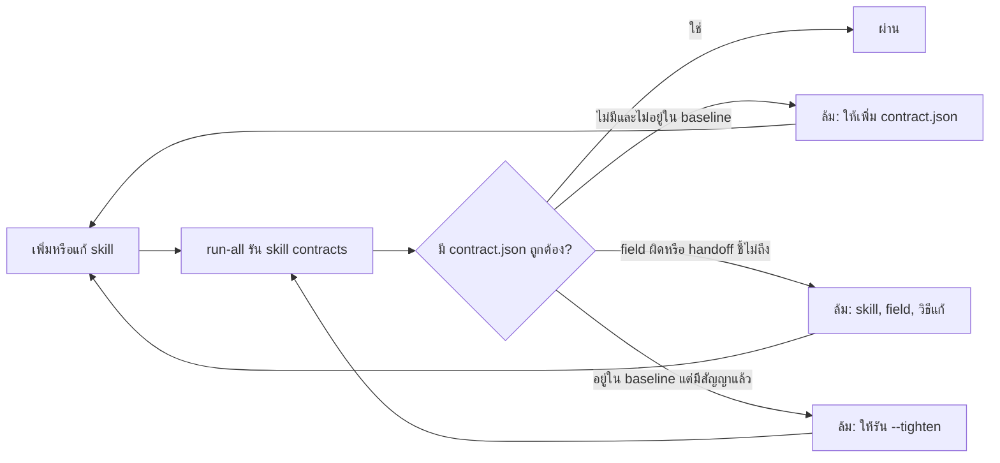

# Design

## Work type

feature

## เส้นทางผู้ใช้

เส้นทางของคนหรือ agent ที่เพิ่มหรือแก้ skill แล้วรัน gate รวมทางที่ล้ม



## Decisions

- **Decision ID:** DEC-001
  - **Status:** accepted
  - **Decision:** เก็บสัญญาเป็น contract.json ข้าง SKILL.md ไม่ใส่ใน frontmatter
  - **Why:** frontmatter ถูก host หลายตัว (Claude Code, Codex, Pi) อ่านและอาจเข้า context ทุก session; ไฟล์แยกไม่กิน context และตรวจด้วย schema ได้
  - **Rejected:** none
  - **Consequences:** contract.json ติดไปกับ .claude/skills ที่ติดตั้งให้ผู้ใช้แต่ไม่มีอะไรอ่าน และคนแก้ skill ต้องแก้สองไฟล์
- **Decision ID:** DEC-002
  - **Status:** accepted
  - **Decision:** ตัวตรวจอยู่ใต้ scripts/lint ไม่ใส่ใน skill-suite-auditor ที่ติดตั้งให้ผู้ใช้
  - **Why:** skill ของผู้ใช้ไม่มี contract.json การบังคับในตัวตรวจที่ติดตั้งให้จะทำให้ผู้ใช้เจอ finding ทันที
  - **Rejected:** none
  - **Consequences:** ผู้ใช้ยังไม่ได้ประโยชน์จากการตรวจนี้จนกว่าจะมีงานแยก
- **Decision ID:** DEC-003
  - **Status:** accepted
  - **Decision:** skill ที่ยังไม่มีสัญญาอยู่ใน baseline ที่ลดได้อย่างเดียว
  - **Why:** เปิด check ได้ทันทีโดยไม่ต้องเขียนสัญญา 41 ชิ้นก่อน และ skill ใหม่ต้องมีสัญญาตั้งแต่วันแรก
  - **Rejected:** none
  - **Consequences:** skill เดิม 33 ตัวยังไม่มีสัญญาจนกว่าจะเก็บกวาด

## ตารางความล้มเหลว

| Failure | User sees | Recovery | Covers |
|---|---|---|---|
| ขาด field | finding ระบุ skill และ path ของ field ที่ขาด | No separate step; the outcome is the handling | contract-shape |
| kind ไม่รู้จัก | finding ระบุ path ของ kind และรายการที่ยอมรับ | No separate step; the outcome is the handling | contract-shape |
| JSON เสีย | finding ระบุไฟล์ ไม่ถือว่าผ่าน | No separate step; the outcome is the handling | contract-shape |
| skill ปลายทางไม่มี | finding ระบุ skill ต้นทางและปลายทางที่ไม่มี | No separate step; the outcome is the handling | handoff-resolution |
| รูปแบบปลายทางผิด | finding ระบุรูปแบบที่ยอมรับ | No separate step; the outcome is the handling | handoff-resolution |
| git ไม่มีคนตัดสินใจ | finding บอกให้ระบุสิ่งที่คนต้องตัดสินใจ | No separate step; the outcome is the handling | human-accountability |
| ส่งต่อคนแต่ไม่บอกคนทำอะไร | finding บอกให้ระบุสิ่งที่คนทำหรือตัดสินใจ | No separate step; the outcome is the handling | human-accountability |
| skill ใหม่ไม่มีสัญญา | exit ไม่ใช่ 0 พร้อมชื่อ skill และให้เพิ่ม contract.json | No separate step; the outcome is the handling | missing-contract-ratchet |
| baseline เสีย | exit ไม่ใช่ 0 พร้อมชื่อไฟล์ | No separate step; the outcome is the handling | missing-contract-ratchet |

## แผนที่ไฟล์

| Tasks | Paths |
|---|---|
| T001 | `scripts/lint/skill-contracts.mjs` (add), `scripts/lint/test/skill-contracts.test.mjs` (add) |
| T002 | `.claude/skills/investigate/contract.json` (add), `.claude/skills/change/contract.json` (add), `.claude/skills/build/contract.json` (add), `.claude/skills/prove/contract.json` (add), `.claude/skills/land/contract.json` (add), `.claude/skills/dev/contract.json` (add), `.claude/skills/feature/contract.json` (add), `.claude/skills/changes/contract.json` (add), `quality/baselines/skill-contracts-v1.json` (add), `scripts/lint/test/lifecycle-contracts.test.mjs` (add) |
| T003 | `.claude/tests/run-all.sh`, `.claude/tests/affected-suite-selector.mjs`, `.claude/tests/harness/affected-suite-selector.test.mjs`, `.claude/tests/README.md`, `CLAUDE.md`, `quality/README.md` |

`+` add · `~` change · `-` remove

```text
.
├── .claude/
│   ├── skills/
│   │   ├── build/
│   │   │   └── + contract.json
│   │   ├── change/
│   │   │   └── + contract.json
│   │   ├── changes/
│   │   │   └── + contract.json
│   │   ├── dev/
│   │   │   └── + contract.json
│   │   ├── feature/
│   │   │   └── + contract.json
│   │   ├── investigate/
│   │   │   └── + contract.json
│   │   ├── land/
│   │   │   └── + contract.json
│   │   └── prove/
│   │       └── + contract.json
│   └── tests/
│       ├── ~ affected-suite-selector.mjs
│       ├── harness/
│       │   └── ~ affected-suite-selector.test.mjs
│       ├── ~ README.md
│       └── ~ run-all.sh
├── ~ CLAUDE.md
├── quality/
│   ├── baselines/
│   │   └── + skill-contracts-v1.json
│   └── ~ README.md
└── scripts/
    └── lint/
        ├── + skill-contracts.mjs
        └── test/
            ├── + lifecycle-contracts.test.mjs
            └── + skill-contracts.test.mjs
```

## แผนที่ test

| Scenario | Level | Check | Task |
|---|---|---|---|
| สัญญาครบ; ขาด field; kind ไม่รู้จัก; JSON เสีย; ชื่อไม่ตรงโฟลเดอร์; skill ปลายทางไม่มี; command ปลายทางมีอยู่; รูปแบบปลายทางผิด; git ไม่มีคนตัดสินใจ; agreement มีคนอนุมัติ; ส่งต่อคนแต่ไม่บอกคนทำอะไร; repo ตรง baseline; skill ใหม่ไม่มีสัญญา; baseline ค้าง; baseline เสีย | task check | `node --test scripts/lint/test/skill-contracts.test.mjs` | T001 |
| Land อยู่กับคน; Change ส่งต่อให้คนอนุมัติ | task check | `node --test scripts/lint/test/lifecycle-contracts.test.mjs` | T002 |
| แก้ skill; แก้ไฟล์อื่น | task check | `node --test .claude/tests/harness/affected-suite-selector.test.mjs` | T003 |
