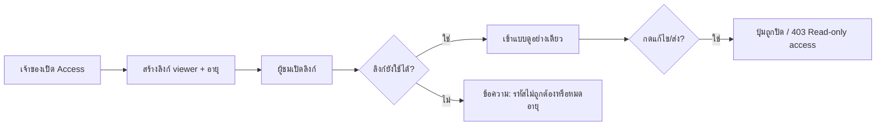

# Design

## Work type

feature, ui, security

## เส้นทางผู้ใช้

เจ้าของเชิญผู้ชมแบบดูอย่างเดียว และกรณีถูกปฏิเสธ



## โมเดลโดเมนและโมดูล

| Component | Responsibility | Files | Tasks |
|---|---|---|---|
| Access server | บทบาท ลิงก์เชิญ การเพิกถอน และ audit | pi-extensions/team-webui/server.ts | T001, T002, T003 |
| UI helpers | ย่อพาธ เลือกไฟล์แนบ และพจนานุกรมภาษา | pi-extensions/team-webui/web/ui-helpers.js, pi-extensions/team-webui/web/i18n.js | T002, T003 |
| Workspace client | หน้าแชท แถบหัว มือถือ ความช่วยเหลือ Access dialog | pi-extensions/team-webui/web/app.js, pi-extensions/team-webui/web/index.html, pi-extensions/team-webui/web/style.css | T003 |
| Task board | ชื่อโปรเจกต์ ปุ่มเลือกขั้น คำอธิบายขั้น | pi-extensions/team-webui/web/tasks.js, pi-extensions/team-webui/web/tasks.css | T003 |

## สัญญา UI

### Tasks board

| State | Shows | Actions |
|---|---|---|
| loading | Loading tasks… | — |
| empty | ขั้นที่เลือกไม่มีงาน พร้อมจำนวนงานในขั้นอื่นบนปุ่มเลือกขั้น | — |
| error | ข้อความผิดพลาดใน task-feedback | — |
| success | ปุ่มเลือกขั้นพร้อมจำนวน และคอลัมน์ของขั้นที่เลือก (มือถือ) หรือทุกคอลัมน์ (เดสก์ท็อป) | — |

- **Accessibility:** ปุ่มเลือกขั้นใช้ aria-pressed; หัวคอลัมน์มีคำอธิบายผ่าน aria-describedby

### Access dialog

| State | Shows | Actions |
|---|---|---|
| loading | Loading access… | — |
| empty | No extra invites. Create one below. | — |
| error | ข้อความผิดพลาดในกล่อง | — |
| success | รายการลิงก์เชิญ บทบาท วันหมดอายุ ปุ่มเพิกถอน และกิจกรรมล่าสุด | — |

- **Accessibility:** dialog มีหัวเรื่อง ปุ่มทุกปุ่มมีชื่อ ใช้คีย์บอร์ดได้

## การเสริมความปลอดภัย

| ส่วน | รายละเอียด |
|---|---|
| จุดอ่อน | ลิงก์เชิญเดียวให้สิทธิ์เต็มและไม่มีวันหมดอายุหรือบันทึก |
| มาตรการ | บทบาท viewer/member, ลิงก์หมดอายุ เพิกถอนได้, audit log |
| วิธีพิสูจน์ | server.test.mjs ทดสอบ viewer ถูกปฏิเสธ, ลิงก์หมดอายุ, เพิกถอนตัด session และ audit |

## Decisions

- **Decision ID:** DEC-001
  - **Status:** accepted
  - **Decision:** เก็บลิงก์เชิญเพิ่มเติมและ audit ในหน่วยความจำ hub
  - **Why:** hub เป็นกระบวนการเดียวที่มีอายุชั่วคราว และไม่ต้องสร้างไฟล์ความลับใหม่บนดิสก์
  - **Rejected:** none
  - **Consequences:** ลิงก์เชิญเพิ่มเติมและ audit หายเมื่อ /serve stop
- **Decision ID:** DEC-002
  - **Status:** accepted
  - **Decision:** รหัสหลักจาก /serve ยังเป็นบทบาท member และไม่เปลี่ยน
  - **Why:** รักษาความเข้ากันได้กับ /serve status และการตรวจ health ของ hub
  - **Rejected:** none
  - **Consequences:** เพิกถอนรหัสหลักต้องใช้ /serve stop แล้ว /serve ใหม่
- **Decision ID:** DEC-003
  - **Status:** accepted
  - **Decision:** แปลป้ายหน้าจอด้วยพจนานุกรมสองทางใน i18n.js โดยข้ามเนื้อหาแชท โค้ด และไฟล์
  - **Why:** ครอบคลุมป้ายแบบคงที่และแบบไดนามิกโดยไม่แตะเนื้อหาผู้ใช้
  - **Rejected:** none
  - **Consequences:** ข้อความใหม่ที่ไม่อยู่ในพจนานุกรมจะแสดงเป็นภาษาอังกฤษจนกว่าจะเพิ่มคำแปล
- **Decision ID:** DEC-ISSUE-SCOPE
  - **Status:** accepted
  - **Context:** จะแก้ issue ใดบ้าง
  - **Decision:** แก้ทั้งหมด 15 ข้อตามรายงาน persona-usability-issues.md
  - **Why:** No alternative was open; recorded as settled
  - **Rejected:** none
  - **Consequences:** Not stated in the draft
  - **Decided by:** user

## Threat model

**ทรัพย์สินและประเภทข้อมูล:** ไฟล์และ Git ของ worktree; การส่งคำสั่งให้ Pi session; รหัสเชิญ

**ขอบเขตความเชื่อถือ:** เบราว์เซอร์ผู้ได้รับเชิญ ไปยัง hub HTTP

| ID | STRIDE | ภัยคุกคาม | โอกาส × ผลกระทบ | มาตรการควบคุม | Scenario | ความเสี่ยงคงเหลือ |
|---|---|---|---|---|---|---|
| t1 | elevation-of-privilege | ผู้ชมส่ง POST ตรงเพื่อแก้ไฟล์หรือ commit | medium × high | ตรวจบทบาทที่ server ก่อนทุก POST | — | low |
| t2 | spoofing | ลิงก์เชิญรั่วแล้วถูกใช้ภายหลัง | medium × high | ลิงก์มีวันหมดอายุและเพิกถอนได้ทันที พร้อมตัด session | — | low |
| t3 | repudiation | ไม่รู้ว่าใครแก้ไฟล์หรือ commit | medium × medium | audit log ของทุก POST ที่เปลี่ยนสถานะ | — | low |
| t4 | information-disclosure | ผู้ชมอ่านรหัสเชิญหลักผ่าน /api/invite | medium × high | endpoint เชิญและ audit ใช้ได้เฉพาะบทบาท member | — | low |

## ตารางความล้มเหลว

| Failure | User sees | Recovery | Covers |
|---|---|---|---|
| รหัสผิด | แสดง Access code is invalid or expired. Ask the host for a new invite. | วางรหัสใหม่แล้วกด Open workspace | webui-login-feedback |
| session หมดอายุ | กลับหน้าเข้าใช้พร้อม Your access ended. Sign in again. | ใส่รหัสอีกครั้ง | webui-login-feedback |
| viewer ส่ง POST ไม่ได้ | ได้ 403 Read-only access. | ขอลิงก์ member จากเจ้าของ | webui-viewer-role |
| viewer อ่านรหัสหลักไม่ได้ | ได้ 403 | No separate step; the outcome is the handling | webui-viewer-role |
| ลิงก์หมดอายุ | ได้ 401 Access code is invalid or expired. | ขอลิงก์ใหม่ | webui-invite-lifecycle |
| ค่าที่ไม่รองรับ | ได้ 400 | No separate step; the outcome is the handling | webui-invite-lifecycle |
| viewer สร้างลิงก์ไม่ได้ | ได้ 403 | No separate step; the outcome is the handling | webui-invite-lifecycle |
| บันทึกการปฏิเสธ | audit มีรายการ Bo viewer save 403 | No separate step; the outcome is the handling | webui-audit-log |
| มีไฟล์ใหญ่เกิน | แนบไฟล์เล็ก และแจ้งว่า big.bin เกิน 20 MB | ย่อไฟล์แล้วแนบใหม่ | webui-attachment-partial |
| ชื่อไม่ถูกต้อง | แสดงข้อความว่าชื่อ branch ไม่ถูกต้องและไม่ส่งคำขอ | แก้ชื่อแล้วกดสร้าง | webui-git-dialogs |

## แผนที่ไฟล์

| Tasks | Paths |
|---|---|
| T001; T002; T003 | `pi-extensions/team-webui/server.ts` |
| T001 | `pi-extensions/team-webui/test/server.test.mjs` |
| T002 | `pi-extensions/team-webui/web/ui-helpers.js` (add), `pi-extensions/team-webui/web/i18n.js` (add), `pi-extensions/team-webui/test/ui-helpers.test.mjs` (add) |
| T003 | `pi-extensions/team-webui/web/`, `pi-extensions/team-webui/test/` |
| T004 | `pi-extensions/team-webui/README.md`, `pi-extensions/CHANGELOG.md` |

`+` add · `~` change · `-` remove

```text
.
└── pi-extensions/
    ├── ~ CHANGELOG.md
    └── team-webui/
        ├── ~ README.md
        ├── ~ server.ts
        ├── ~ test/
        │   ├── ~ server.test.mjs
        │   └── + ui-helpers.test.mjs
        └── ~ web/
            ├── + i18n.js
            └── + ui-helpers.js
```

## แผนที่ test

| Scenario | Level | Check | Task |
|---|---|---|---|
| viewer อ่านได้; viewer ส่ง POST ไม่ได้; viewer อ่านรหัสหลักไม่ได้; member ส่ง POST ได้; viewer ออกจากระบบได้; สร้างลิงก์ viewer; ลิงก์หมดอายุ; เพิกถอนตัด session; ค่าที่ไม่รองรับ; viewer สร้างลิงก์ไม่ได้; บันทึก commit; บันทึกการปฏิเสธ; ไม่เก็บความลับ; รหัสผิด; session หมดอายุ | task check | `cd pi-extensions && node --test team-webui/test/server.test.mjs` | T001 |
| ตัวเลือกโปรเจกต์อ่านง่าย; tooltip session ไม่เผยพาธเต็ม; พาธสั้น; แนบ 12 ไฟล์; มีไฟล์ใหญ่เกิน; ครบ 10 แล้ว; สร้าง worktree; ชื่อไม่ถูกต้อง; ยกเลิก; เลือกภาษาไทย; เลือกภาษาอังกฤษ; ไม่แปลข้อความแชท | task check | `cd pi-extensions && node --test team-webui/test/ui-helpers.test.mjs` | T002 |
| ตัวเลือกโปรเจกต์อ่านง่าย; tooltip session ไม่เผยพาธเต็ม; พาธสั้น; มือถือเห็นการ์ดทันที; เดสก์ท็อปไปยังขั้นที่อยู่นอกจอ; ขั้นที่เลือกว่าง; คำอธิบายขั้น; ชื่อ session อ่านได้; แตะ session เดิม; รหัสผิด; session หมดอายุ; เปิดความช่วยเหลือ; คำแนะนำครั้งแรก; เลือกภาษาไทย; เลือกภาษาอังกฤษ; ไม่แปลข้อความแชท; viewer อ่านได้; viewer ส่ง POST ไม่ได้; viewer อ่านรหัสหลักไม่ได้; member ส่ง POST ได้; viewer ออกจากระบบได้; สร้างลิงก์ viewer; ลิงก์หมดอายุ; เพิกถอนตัด session; ค่าที่ไม่รองรับ; viewer สร้างลิงก์ไม่ได้; บันทึก commit; บันทึกการปฏิเสธ; ไม่เก็บความลับ; skip link; ประกาศคำตอบ; หัวข้อในข้อความ; เป้าสัมผัส; แนบ 12 ไฟล์; มีไฟล์ใหญ่เกิน; ครบ 10 แล้ว; ช่องว่าง; พิมพ์แล้ว; มีแต่ช่องว่าง; สร้าง worktree; ชื่อไม่ถูกต้อง; ยกเลิก; 6 agents; ไม่มี agent; stylesheet ใน head; คอนทราสต์ inline code | task check | `cd pi-extensions && node team-webui/test/browser-run.mjs team-webui/test/usability-browser.py` | T003 |
| viewer อ่านได้; viewer ส่ง POST ไม่ได้; viewer อ่านรหัสหลักไม่ได้; member ส่ง POST ได้; viewer ออกจากระบบได้; สร้างลิงก์ viewer; ลิงก์หมดอายุ; เพิกถอนตัด session; ค่าที่ไม่รองรับ; viewer สร้างลิงก์ไม่ได้; เลือกภาษาไทย; เลือกภาษาอังกฤษ; ไม่แปลข้อความแชท | task check | `cd pi-extensions && npm test` | T004 |
