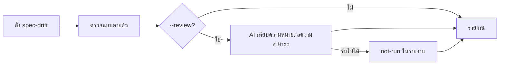

# Design

## สถานะปัจจุบัน

ไม่มีคำสั่งเทียบสเปกที่ archive แล้วกับโค้ด สเปกแทบไม่อ้าง path ตรงๆ แต่ change ที่ archive เก็บ claim ต่อ requirement ใน evidence.yaml และ paths/verify ต่อ task ใน tasks.md

## Work type

feature

## สถาปัตยกรรม

โมดูล spec-drift.mjs อ่าน openspec/specs หา change ล่าสุดใน openspec/changes/archive ที่มี requirement เดียวกัน ผูก task ผ่าน claim แล้วตรวจว่าไฟล์ยังอยู่ ส่วน --review ใช้ createPromptReviewer จาก spec-review.mjs ทีละความสามารถ

## เส้นทางผู้ใช้

ผู้ใช้ตรวจ drift แล้วตัดสินว่าจะแก้สเปกหรือโค้ด



## Decisions

- **Decision ID:** DEC-001
  - **Status:** accepted
  - **Decision:** ตรวจแบบตายตัวเสมอ และใช้ AI เมื่อสั่ง --review
  - **Why:** ผู้ใช้เลือก
  - **Rejected:** none
  - **Consequences:** การตรวจตายตัวจับได้แค่ไฟล์ที่หายหรือ requirement ที่หาที่มาไม่เจอ ไม่จับพฤติกรรมที่เปลี่ยน
- **Decision ID:** DEC-002
  - **Status:** accepted
  - **Decision:** ไม่ระบุความสามารถ = ตรวจตายตัวทั้งหมด; --review ต้องระบุ --capability อย่างน้อยหนึ่ง
  - **Why:** ผู้ใช้เลือก เพื่อคุมค่าโมเดล
  - **Rejected:** none
  - **Consequences:** ต้องรัน AI ทีละกลุ่มถ้าต้องการครอบคลุมทั้งหมด
- **Decision ID:** DEC-003
  - **Status:** accepted
  - **Decision:** ผูก requirement กับไฟล์ผ่าน change ที่ archive ล่าสุดที่เขียน requirement นั้น (claims ใน evidence.yaml และ paths/verify ใน tasks.md)
  - **Why:** สเปกแทบไม่อ้าง path ตรงๆ (16 ครั้งจาก 500 requirement)
  - **Rejected:** none
  - **Consequences:** requirement ที่ไม่มีต้นทางใน archive จะรายงานเป็น no-origin
- **Decision ID:** DEC-004
  - **Status:** accepted
  - **Decision:** AI ใช้ createPromptReviewer และกติกา retry/not-run เดียวกับ spec-review
  - **Why:** ไม่สร้างระบบ reviewer ซ้ำ
  - **Rejected:** none
  - **Consequences:** ต้องมี configured reviewer CLI; ไม่มีก็เป็น not-run

## ตารางความล้มเหลว

| Failure | User sees | Recovery | Covers |
|---|---|---|---|
| ไฟล์ที่ผูกไว้หายไป | requirement นั้นถูกรายงาน missing-file พร้อม path | No separate step; the outcome is the handling | deterministic-drift |
| path ในข้อความสเปกหาย | รายงาน missing-file | No separate step; the outcome is the handling | deterministic-drift |
| ความสามารถไม่มีอยู่ | คำสั่งล้มเหลวพร้อมชื่อนั้น | ระบุชื่อใน openspec/specs | deterministic-drift |
| ไฟล์ archive เสียหรือรูปแบบเก่า | requirement ที่ผูกกับ change นั้นเป็น unreadable พร้อม path ไม่นับว่า ok | No separate step; the outcome is the handling | deterministic-drift |
| --review ไม่ระบุความสามารถ | คำสั่งปฏิเสธโดยไม่ spawn reviewer | ระบุ --capability | ai-drift-review |
| reviewer ล้มเหลว | ความสามารถนั้นเป็น not-run พร้อมเหตุผล ไม่นับว่าตรง | No separate step; the outcome is the handling | ai-drift-review |

## แผนที่ไฟล์

| Tasks | Paths |
|---|---|
| T001 | `.claude/harness/runtime/workflow/change/spec-drift.mjs` (add), `.claude/harness/tests/spec-drift.test.mjs` (add) |
| T002 | `.claude/harness/runtime/core/cli-router.mjs`, `.claude/harness/commands.json`, `.claude/harness/runtime/composition/`, `.claude/harness/foundation.mjs`, `.claude/harness/fixtures/public-command-contract-v1.json`, `.claude/harness/tests/public-command-golden.test.mjs`, `.claude/harness/tests/spec-drift-command.test.mjs` (add), `cli.sh`, `.claude/tests/harness/run-installer-tests.sh` |
| T003 | `.claude/harness/README.md`, `docs/feature-map.json`, `docs/feature-map.md`, `openspec/feature-map.json`, `CHANGELOG.md`, `.claude/tests/run-all.sh`, `.claude/tests/README.md` |

`+` add · `~` change · `-` remove

```text
.
├── .claude/
│   ├── harness/
│   │   ├── ~ commands.json
│   │   ├── fixtures/
│   │   │   └── ~ public-command-contract-v1.json
│   │   ├── ~ foundation.mjs
│   │   ├── ~ README.md
│   │   ├── runtime/
│   │   │   ├── ~ composition/
│   │   │   ├── core/
│   │   │   │   └── ~ cli-router.mjs
│   │   │   └── workflow/
│   │   │       └── change/
│   │   │           └── + spec-drift.mjs
│   │   └── tests/
│   │       ├── ~ public-command-golden.test.mjs
│   │       ├── + spec-drift-command.test.mjs
│   │       └── + spec-drift.test.mjs
│   └── tests/
│       ├── harness/
│       │   └── ~ run-installer-tests.sh
│       ├── ~ README.md
│       └── ~ run-all.sh
├── ~ CHANGELOG.md
├── ~ cli.sh
├── docs/
│   ├── ~ feature-map.json
│   └── ~ feature-map.md
└── openspec/
    └── ~ feature-map.json
```

## แผนที่ test

| Scenario | Level | Check | Task |
|---|---|---|---|
| ไฟล์ที่ผูกไว้หายไป; ทุกไฟล์ยังอยู่; หาที่มาไม่เจอ; path ในข้อความสเปกหาย; ระบุความสามารถ; ความสามารถไม่มีอยู่; ไฟล์ archive เสียหรือรูปแบบเก่า; ความสามารถที่ไม่มี requirement; รีวิวความสามารถที่เลือก; --review ไม่ระบุความสามารถ; reviewer ล้มเหลว; ไม่มี --review ไม่เรียก AI; ไม่แตะไฟล์โปรเจกต์; exit code | task check | `node --test .claude/harness/tests/spec-drift.test.mjs` | T001 |
| ไฟล์ที่ผูกไว้หายไป; ทุกไฟล์ยังอยู่; หาที่มาไม่เจอ; path ในข้อความสเปกหาย; ระบุความสามารถ; ความสามารถไม่มีอยู่; ไฟล์ archive เสียหรือรูปแบบเก่า; ความสามารถที่ไม่มี requirement; รีวิวความสามารถที่เลือก; --review ไม่ระบุความสามารถ; reviewer ล้มเหลว; ไม่มี --review ไม่เรียก AI; ไม่แตะไฟล์โปรเจกต์; exit code | task check | `node --test .claude/harness/tests/spec-drift-command.test.mjs .claude/harness/tests/public-command-golden.test.mjs` | T002 |
| ไม่แตะไฟล์โปรเจกต์; exit code | task check | `bash .claude/tests/docs/run-doc-consistency.sh` | T003 |
