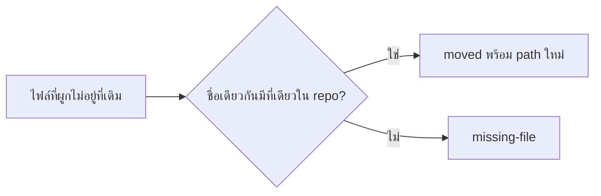

# Change: spec-drift แยกไฟล์ที่ถูกย้ายออกจากไฟล์ที่หายจริง

- **Change:** `spec-drift-moved-files` · **Lane:** rapid (low risk)
- **Review:** not required · **Owner:** unassigned · **Created:** 2026-11-26

## สรุป

รายงาน spec-drift บอกได้ว่าไฟล์ถูกย้ายไปไหน แทนที่จะนับรวมกับไฟล์ที่หายจริง

## เหตุผล

[Data] รันกับ repo นี้พบ 276 requirement ที่ไฟล์หาย ส่วนใหญ่เพราะไฟล์ runtime ถูกย้ายเข้าโฟลเดอร์ย่อย ทำให้ไฟล์ที่หายจริงถูกกลบ

## ขอบเขต

- **อยู่ในขอบเขต (`spec-drift`):** requirement ที่ไฟล์หายทุกตัวถูกย้ายมีสถานะ moved; ถ้ายังมีไฟล์ที่หายจริงเป็น missing-file
- **นอกขอบเขต:** สิ่งที่ไม่ทำ (Non-goals) ด้านล่าง

## Non-goals

- แก้สเปกให้ชี้ path ใหม่อัตโนมัติ
- เดาที่อยู่ใหม่เมื่อมีไฟล์ชื่อเดียวกันหลายที่

## ผลกระทบและความเสี่ยง

ความเสี่ยงต่ำ: แก้เฉพาะจุด ไม่กระทบส่วนอื่น

- **Impact:** low
- **Coupling:** isolated

## การสื่อสาร การดูแลหลังปล่อย และ release note

### Release note

spec-drift รายงานไฟล์ที่ถูกย้ายเป็น moved พร้อมที่อยู่ใหม่ แยกจากไฟล์ที่หายจริง

## รายละเอียดทางเทคนิค

ส่วนนี้สำหรับนักพัฒนาและผู้รีวิว: ไฟล์ที่แตะ, การวิเคราะห์ทางเทคนิค, เกณฑ์ผ่าน และนิยามของงานเสร็จ

### ไฟล์และ repository

- **นอกขอบเขต:** การแก้นอกไฟล์ `.claude/harness/runtime/workflow/change/spec-drift.mjs`, `.claude/harness/tests/spec-drift.test.mjs`, `CHANGELOG.md`, `.claude/harness/README.md`, `.claude/harness/commands.json`, `.claude/harness/fixtures/public-command-contract-v1.json`

## User flow

ผู้ใช้เห็นว่าไฟล์ถูกย้ายหรือหายจริง

## Work type

feature

## Failure matrix

| Failure | User sees | Recovery | Covers |
|---|---|---|---|
| glob ที่โฟลเดอร์หาย | ยังเป็น missing-file เพราะ glob ย้ายตามชื่อไม่ได้ | No separate step; the outcome is the handling | moved-files |

## เกณฑ์ผ่าน

Task: `tasks.md`; scenario: ใน specs

| Requirement | Scenario | ชนิด | Task | Check | Decision |
|---|---|---|---|---|---|
| moved-files | ไฟล์ย้ายเข้าโฟลเดอร์ย่อย | success | T001 | test: `.claude/harness/tests/spec-drift.test.mjs` | — |
|  | ชื่อซ้ำหลายที่ | boundary | T001 |  |  |
|  | ย้ายบางไฟล์ หายบางไฟล์ | boundary | T001 |  |  |
|  | glob ที่โฟลเดอร์หาย | failure | T001 |  |  |

## นิยามของงานเสร็จ

- Fresh evidence for every claim (4).
- Changed tests fail on the original code.
- Review: not required (rapid lane, low tier: deterministic evidence only).
- Land archives it; Land never commits.
- Success: acceptance scenarios above pass.
