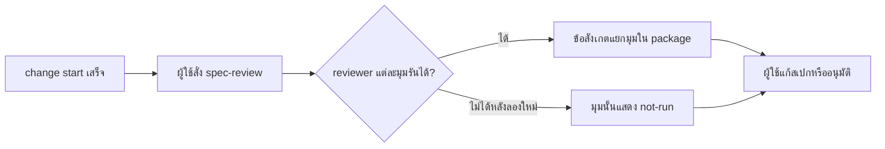

# Design

## สถานะปัจจุบัน

configured reviewer (claude-cli, codex-cli) รันใน session ใหม่แบบ read-only และ ephemeral อยู่แล้วสำหรับรีวิวโค้ดตอน Prove แต่ prompt และ schema ผูกกับ diff, claimIds และ verificationCaseIds จึงใช้ตรวจสเปกตรง ๆ ไม่ได้ หน้าอนุมัติ (package) แสดงความเสี่ยง การตัดสินใจ และคำเตือนแบบตายตัว

## Work type

feature

## สถาปัตยกรรม

โมดูลใหม่ spec-review.mjs ใต้ workflow/change สร้าง prompt และ schema ของแต่ละมุม แล้วเรียกขั้นตอน spawn ของ configured reviewer ที่มีอยู่ซ้ำ ผลเก็บที่ .foundation/spec-reviews/<change>/ พร้อม digest ของ packet ที่รีวิว approval-package อ่านผลล่าสุดและเทียบ digest เพื่อบอกว่าเป็นผลปัจจุบันหรือ stale

## เส้นทางผู้ใช้

ผู้อนุมัติสั่งรีวิวสเปกก่อนอนุมัติ รวมกรณี reviewer รันไม่ได้



## Decisions

- **Decision ID:** DEC-001
  - **Status:** accepted
  - **Decision:** รันเมื่อผู้ใช้หรือ agent สั่งด้วยคำสั่ง spec-review เท่านั้น
  - **Why:** ผู้ใช้เลือก เพื่อไม่เพิ่มเวลาและค่าโมเดลให้ทุก change
  - **Rejected:** none
  - **Consequences:** change ที่ไม่มีใครสั่งรีวิวจะไม่ได้รับประโยชน์ ต้องบอกผู้ใช้ว่ามีคำสั่งนี้ในหน้าอนุมัติ
- **Decision ID:** DEC-002
  - **Status:** accepted
  - **Decision:** แยก 3 session ต่อมุม (comprehension, implementation-readiness, zoom-out)
  - **Why:** ผู้ใช้เลือกแบบ EGM เพื่อเพิ่มโอกาสเจอปัญหา แลกค่าใช้จ่ายราว 3 เท่า
  - **Rejected:** none
  - **Consequences:** ค่าโมเดลและเวลาราว 3 เท่าของรีวิวหนึ่ง session ต่อครั้งที่สั่ง
- **Decision ID:** DEC-003
  - **Status:** accepted
  - **Decision:** เลือกรุ่นโมเดลตามระดับความเสี่ยงด้วยกติกาเดียวกับรีวิวโค้ดตอน Prove
  - **Why:** ผู้ใช้เลือก ใช้ reviewerModelForTier ที่มีอยู่
  - **Rejected:** none
  - **Consequences:** change ระดับ low ใช้รุ่น fast จึงตรวจได้ตื้นกว่า
- **Decision ID:** DEC-004
  - **Status:** accepted
  - **Decision:** ผลรีวิวเป็นคำแนะนำ ไม่บล็อก --approve-spec
  - **Why:** ผู้ใช้เลือก และตรงกับกติกาที่ Land เป็นด่านบังคับเดียว
  - **Rejected:** none
  - **Consequences:** ข้อสังเกตที่ถูกต้องอาจถูกมองข้าม เพราะผู้ใช้อนุมัติได้เสมอ

## ตารางความล้มเหลว

| Failure | User sees | Recovery | Covers |
|---|---|---|---|
| change ไม่มีอยู่ | คำสั่งล้มเหลวพร้อมข้อความระบุ id และไม่ spawn reviewer | ระบุ id ของ change ที่มีอยู่ | on-demand-spec-review |
| change เข้า Land แล้ว | คำสั่งปฏิเสธโดยไม่ spawn reviewer | ใช้กับ change ที่ยังไม่ Land | on-demand-spec-review |
| reviewer ใช้ session ของผู้ร่างสเปกซ้ำ | มุมนั้นถูกบันทึกเป็น not-run ไม่นับผล | รัน spec-review ใหม่ | three-isolated-lenses |
| reviewer ล้มเหลวสองครั้ง | มุมนั้นเป็น not-run พร้อมเหตุผล และสรุปไม่แสดงว่าผ่าน | แก้ reviewer แล้วรัน spec-review ใหม่ | not-run-status |
| ไม่มี reviewer CLI | ทั้ง 3 มุมเป็น not-run และไม่ fallback ไป main-session | ติดตั้งหรือ login reviewer CLI | not-run-status |

## ความเสี่ยง

- ค่าโมเดลราว 3 เท่าของรีวิวหนึ่งรอบ ต่อครั้งที่สั่ง ลดลงด้วยการรันเมื่อขอเท่านั้นและเลือกรุ่นตามระดับความเสี่ยง
- reviewer อาจให้ข้อสังเกตที่ไม่ถูกต้อง จึงเป็นคำแนะนำเท่านั้น

## แผนที่ไฟล์

| Tasks | Paths |
|---|---|
| T001 | `.claude/harness/runtime/workflow/change/spec-review.mjs` (add), `.claude/harness/runtime/evidence/configured-reviewer.mjs`, `.claude/harness/tests/spec-review.test.mjs` (add) |
| T002 | `.claude/harness/runtime/core/cli-router.mjs`, `.claude/harness/commands.json`, `.claude/harness/runtime/composition/`, `.claude/harness/tests/public-command-golden.test.mjs`, `.claude/harness/tests/spec-review-command.test.mjs` (add) |
| T003 | `.claude/harness/runtime/workflow/change/approval-package.mjs`, `.claude/harness/tests/approval-package.test.mjs` |
| T004 | `.claude/harness/README.md`, `.claude/harness/lifecycle/change.md`, `docs/feature-map.md`, `CHANGELOG.md`, `.claude/tests/run-all.sh`, `.claude/tests/README.md` |

`+` add · `~` change · `-` remove

```text
.
├── .claude/
│   ├── harness/
│   │   ├── ~ commands.json
│   │   ├── lifecycle/
│   │   │   └── ~ change.md
│   │   ├── ~ README.md
│   │   ├── runtime/
│   │   │   ├── ~ composition/
│   │   │   ├── core/
│   │   │   │   └── ~ cli-router.mjs
│   │   │   ├── evidence/
│   │   │   │   └── ~ configured-reviewer.mjs
│   │   │   └── workflow/
│   │   │       └── change/
│   │   │           ├── ~ approval-package.mjs
│   │   │           └── + spec-review.mjs
│   │   └── tests/
│   │       ├── ~ approval-package.test.mjs
│   │       ├── ~ public-command-golden.test.mjs
│   │       ├── + spec-review-command.test.mjs
│   │       └── + spec-review.test.mjs
│   └── tests/
│       ├── ~ README.md
│       └── ~ run-all.sh
├── ~ CHANGELOG.md
└── docs/
    └── ~ feature-map.md
```

## แผนที่ test

| Scenario | Level | Check | Task |
|---|---|---|---|
| สั่งรีวิว change ที่รออนุมัติ; change start ไม่รันรีวิวเอง; change ไม่มีอยู่; change เข้า Land แล้ว; สามมุมแยก session; prompt ไม่มีบทสนทนา; change ระดับ medium ใช้รุ่น standard; reviewer ใช้ session ของผู้ร่างสเปกซ้ำ; reviewer ล้มเหลวครั้งเดียว; reviewer ล้มเหลวสองครั้ง; ไม่มี reviewer CLI | task check | `node --test .claude/harness/tests/spec-review.test.mjs` | T001 |
| สั่งรีวิว change ที่รออนุมัติ; change start ไม่รันรีวิวเอง; change ไม่มีอยู่; change เข้า Land แล้ว | task check | `node --test .claude/harness/tests/spec-review-command.test.mjs .claude/harness/tests/public-command-golden.test.mjs` | T002 |
| แสดงผลในหน้าอนุมัติ; มี blocker แต่ยังอนุมัติได้; packet เปลี่ยนหลังรีวิว; ยังไม่เคยรีวิว | task check | `node --test .claude/harness/tests/approval-package.test.mjs` | T003 |
| สั่งรีวิว change ที่รออนุมัติ; change start ไม่รันรีวิวเอง; change ไม่มีอยู่; change เข้า Land แล้ว | task check | `bash .claude/tests/docs/run-doc-consistency.sh` | T004 |
