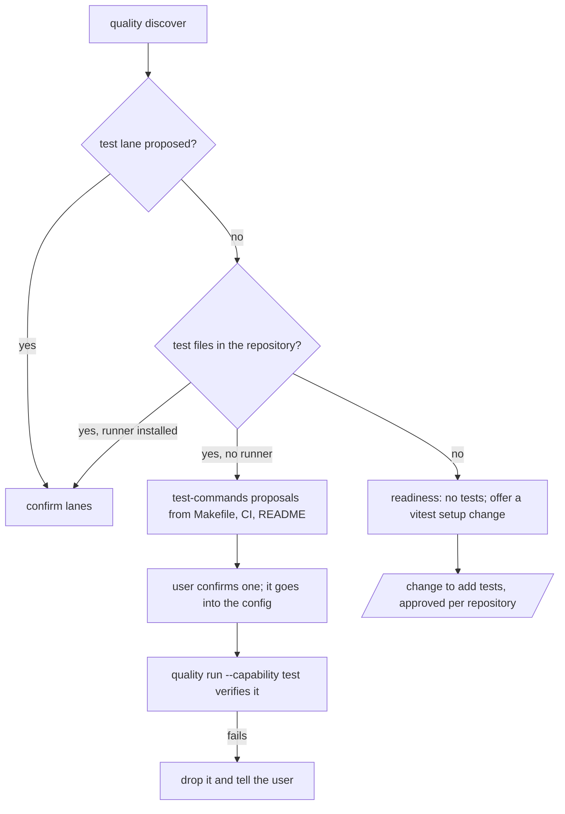

# Design

## Work type

feature

## เส้นทางผู้ใช้

How onboarding handles a repository without a discovered test lane



## ตารางความล้มเหลว

| Failure | User sees | Recovery | Covers |
|---|---|---|---|
| repo Nuxt ไม่มีเทสต์ | proposals.test-setup แนะนำ vitest พร้อมเหตุผลว่าไม่มีเทสต์ | No separate step; the outcome is the handling | no-tests-readiness |
| readiness ไม่มีเทสต์ | unmet และ next บอกว่าไม่มีเทสต์ ให้เสนอตั้งตัวรันผ่าน /change | No separate step; the outcome is the handling | no-tests-readiness |
| pattern ลงท้าย backslash | ถูกปฏิเสธว่า pattern ไม่ถูกต้อง | No separate step; the outcome is the handling | duration-pattern-alone |

## แผนที่ไฟล์

| Tasks | Paths |
|---|---|
| T001 | `.claude/harness/runtime/quality/toolchain-packs.json`, `.claude/harness/runtime/quality/language-profiles.mjs`, `.claude/harness/runtime/quality/quality-discovery.mjs`, `.claude/harness/runtime/quality/test-gap-discovery.mjs` (add), `.claude/harness/runtime/quality/pyramid-readiness.mjs`, `.claude/harness/runtime/composition/pyramid-readiness-command.mjs`, `.claude/harness/tests/test-gap-discovery.test.mjs` (add), `.claude/harness/tests/pyramid-readiness.test.mjs`, `.claude/harness/tests/toolchain-packs.test.mjs`, `.claude/tests/run-all.sh`, `.claude/tests/README.md`, `.claude/harness/CONSUMER-QUALITY.md`, `.claude/skills/onboard/SKILL.md`, `CHANGELOG.md` |

`+` add · `~` change · `-` remove

```text
.
├── .claude/
│   ├── harness/
│   │   ├── ~ CONSUMER-QUALITY.md
│   │   ├── runtime/
│   │   │   ├── composition/
│   │   │   │   └── ~ pyramid-readiness-command.mjs
│   │   │   └── quality/
│   │   │       ├── ~ language-profiles.mjs
│   │   │       ├── ~ pyramid-readiness.mjs
│   │   │       ├── ~ quality-discovery.mjs
│   │   │       ├── + test-gap-discovery.mjs
│   │   │       └── ~ toolchain-packs.json
│   │   └── tests/
│   │       ├── ~ pyramid-readiness.test.mjs
│   │       ├── + test-gap-discovery.test.mjs
│   │       └── ~ toolchain-packs.test.mjs
│   ├── skills/
│   │   └── onboard/
│   │       └── ~ SKILL.md
│   └── tests/
│       ├── ~ README.md
│       └── ~ run-all.sh
└── ~ CHANGELOG.md
```

## แผนที่ test

| Scenario | Level | Check | Task |
|---|---|---|---|
| repo Nuxt; ไฟล์ .vue อย่างเดียว; มีไฟล์เทสต์และ vitest; มีไฟล์เทสต์แต่ไม่มีตัวรัน; Makefile มี target test; CI มีคำสั่งเทสต์; มี lane test แล้ว; repo Nuxt ไม่มีเทสต์; readiness ไม่มีเทสต์; pattern ลงท้าย backslash | task check | `node --test .claude/harness/tests/test-gap-discovery.test.mjs .claude/harness/tests/pyramid-readiness.test.mjs .claude/harness/tests/toolchain-packs.test.mjs` | T001 |
