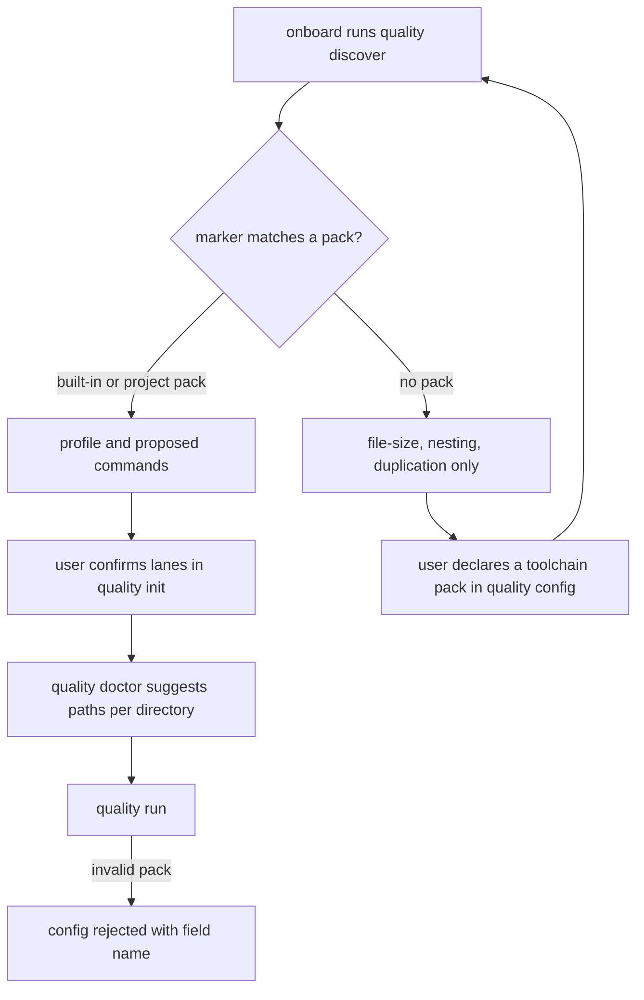

# Design

## Work type

feature

## เส้นทางผู้ใช้

How onboarding sets up lanes for a repository in any language



## Decisions

- **Decision ID:** DEC-001
  - **Status:** accepted
  - **Decision:** ภาษาและเครื่องมือเก็บเป็นไฟล์ JSON ที่ harness ติดตั้ง และโปรเจกต์ประกาศ pack เพิ่มหรือทับได้ในฟิลด์ toolchains ของ quality/foundation-quality.json
  - **Why:** การเพิ่มภาษาด้วยโค้ดต้องรอออกเวอร์ชันทุกครั้ง ส่วนข้อมูลที่ validate ได้ให้โปรเจกต์รองรับภาษาใหม่ได้ทันที
  - **Rejected:** none
  - **Consequences:** คำสั่งของ pack เป็นข้อเสนอที่ onboard แสดงให้ผู้ใช้ยืนยันเหมือนคำสั่งที่ค้นพบเดิม pack ที่โปรเจกต์ประกาศใช้ชื่อซ้ำกับของ harness ได้เพื่อทับ

## ตารางความล้มเหลว

| Failure | User sees | Recovery | Covers |
|---|---|---|---|
| pack ผิดรูป | ถูกปฏิเสธพร้อมชื่อฟิลด์ | No separate step; the outcome is the handling | project-toolchain-packs |
| profile ที่ไม่มีอยู่ | ถูกปฏิเสธเหมือนเดิม | No separate step; the outcome is the handling | project-toolchain-packs |
| go test ค้าง | รายงานว่าค้าง เวลาเทสต์ 2s | No separate step; the outcome is the handling | lingering-test-run-languages |
| shell line มี --import | --test-force-exit อยู่ถัดจาก --test | No separate step; the outcome is the handling | force-exit-node-options |
| argv มี --test-timeout | --test-force-exit อยู่ถัดจาก --test | No separate step; the outcome is the handling | force-exit-node-options |

## แผนที่ไฟล์

| Tasks | Paths |
|---|---|
| T001; T002 | `.claude/harness/runtime/quality/toolchain-packs.json` (add), `.claude/harness/CONSUMER-QUALITY.md`, `CHANGELOG.md` |
| T001 | `.claude/harness/runtime/quality/language-profiles.mjs`, `.claude/harness/runtime/quality/quality-discovery.mjs`, `.claude/harness/runtime/quality/quality-policy.mjs`, `.claude/harness/runtime/quality/quality-runtime.mjs`, `.claude/harness/tests/toolchain-packs.test.mjs` (add), `.claude/tests/run-all.sh`, `.claude/tests/README.md` |
| T002 | `.claude/harness/runtime/core/node-test-exit.mjs`, `.claude/harness/runtime/core/test-durations.mjs` (add), `.claude/harness/runtime/quality/quality-doctor-hints.mjs`, `.claude/harness/tests/node-test-force-exit.test.mjs`, `.claude/harness/tests/quality-runtime.test.mjs` |

`+` add · `~` change · `-` remove

```text
.
├── .claude/
│   ├── harness/
│   │   ├── ~ CONSUMER-QUALITY.md
│   │   ├── runtime/
│   │   │   ├── core/
│   │   │   │   ├── ~ node-test-exit.mjs
│   │   │   │   └── + test-durations.mjs
│   │   │   └── quality/
│   │   │       ├── ~ language-profiles.mjs
│   │   │       ├── ~ quality-discovery.mjs
│   │   │       ├── ~ quality-doctor-hints.mjs
│   │   │       ├── ~ quality-policy.mjs
│   │   │       ├── ~ quality-runtime.mjs
│   │   │       └── + toolchain-packs.json
│   │   └── tests/
│   │       ├── ~ node-test-force-exit.test.mjs
│   │       ├── ~ quality-runtime.test.mjs
│   │       └── + toolchain-packs.test.mjs
│   └── tests/
│       ├── ~ README.md
│       └── ~ run-all.sh
└── ~ CHANGELOG.md
```

## แผนที่ test

| Scenario | Level | Check | Task |
|---|---|---|---|
| repo Flutter; repo Gradle มี wrapper; repo Terraform; marker อยู่ในโฟลเดอร์ย่อย; repo Go เดิม; ภาษาที่ harness ไม่รู้จัก; profile อ้าง pack ที่ประกาศ; pack ผิดรูป; profile ที่ไม่มีอยู่ | task check | `node --test .claude/harness/tests/toolchain-packs.test.mjs` | T001 |
| go test ค้าง; pytest ช้าจริง; JUnit XML; go test โฟลเดอร์เดียว; make -C; ทั้ง repo; shell line มี --import; argv มี --test-timeout; script ที่รับ --test | task check | `node --test .claude/harness/tests/node-test-force-exit.test.mjs .claude/harness/tests/quality-runtime.test.mjs` | T002 |
