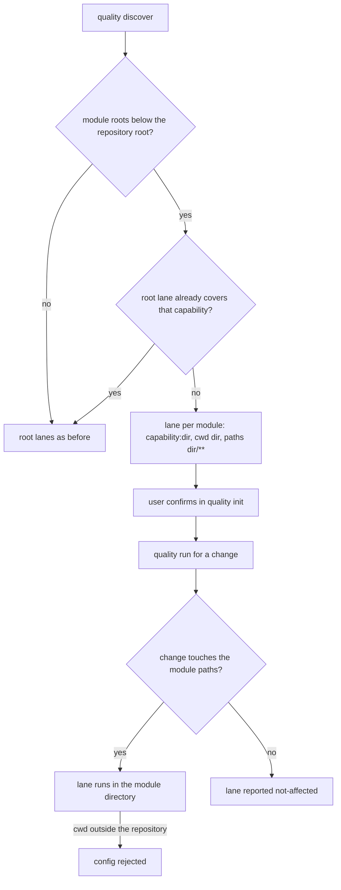

# Design

## Work type

feature

## เส้นทางผู้ใช้

How a monorepo gets one lane per module and a change runs only the touched ones



## Decisions

- **Decision ID:** DEC-001
  - **Status:** accepted
  - **Decision:** provider ใน quality config ใช้ชื่อ <capability>:<name> ได้ capability คือส่วนก่อน : หรือฟิลด์ capability และ cwd เป็นโฟลเดอร์ใน repository
  - **Why:** เก็บรูปแบบ providers เป็น object เดิมไว้ config เก่าจึงไม่ต้องย้าย
  - **Rejected:** none
  - **Consequences:** ไฟล์ผลและ baseline ของ lane ตั้งชื่อจาก key ที่แปลงตัวอักษรนอก [A-Za-z0-9.-] เป็น _

## ตารางความล้มเหลว

| Failure | User sees | Recovery | Covers |
|---|---|---|---|
| cwd ออกนอก repository | ถูกปฏิเสธพร้อมชื่อ provider | No separate step; the outcome is the handling | quality-module-lanes |
| cwd ไม่มีอยู่ | lane fail พร้อมเหตุผลว่าไม่มีโฟลเดอร์ | No separate step; the outcome is the handling | quality-module-lanes |
| duration ไม่มีกลุ่ม | ถูกปฏิเสธว่า pattern ต้องมีกลุ่มดึงตัวเลข | No separate step; the outcome is the handling | toolchain-pack-tightening |
| duration ไม่มี pattern | ถูกปฏิเสธ | No separate step; the outcome is the handling | toolchain-pack-tightening |
| config อ่านไม่ได้ | หยุดพร้อมบอกว่า config อ่านไม่ได้ | No separate step; the outcome is the handling | toolchain-pack-tightening |

## แผนที่ไฟล์

| Tasks | Paths |
|---|---|
| T001; T003 | `.claude/harness/runtime/quality/quality-runtime.mjs` |
| T001 | `.claude/harness/runtime/quality/quality-policy.mjs`, `.claude/harness/runtime/quality/quality-lanes.mjs` (add), `.claude/tests/run-all.sh`, `.claude/tests/README.md` |
| T001; T002 | `.claude/harness/tests/quality-module-lanes.test.mjs` (add) |
| T001; T002; T003 | `.claude/harness/CONSUMER-QUALITY.md`, `CHANGELOG.md` |
| T002 | `.claude/harness/runtime/quality/quality-discovery.mjs`, `.claude/harness/runtime/quality/module-lanes-discovery.mjs` (add) |
| T003 | `.claude/harness/runtime/quality/language-profiles.mjs`, `.claude/harness/runtime/quality/quality-doctor-hints.mjs`, `.claude/harness/runtime/core/node-test-exit.mjs`, `.claude/harness/tests/toolchain-packs.test.mjs`, `.claude/harness/tests/quality-runtime.test.mjs` |

`+` add · `~` change · `-` remove

```text
.
├── .claude/
│   ├── harness/
│   │   ├── ~ CONSUMER-QUALITY.md
│   │   ├── runtime/
│   │   │   ├── core/
│   │   │   │   └── ~ node-test-exit.mjs
│   │   │   └── quality/
│   │   │       ├── ~ language-profiles.mjs
│   │   │       ├── + module-lanes-discovery.mjs
│   │   │       ├── ~ quality-discovery.mjs
│   │   │       ├── ~ quality-doctor-hints.mjs
│   │   │       ├── + quality-lanes.mjs
│   │   │       ├── ~ quality-policy.mjs
│   │   │       └── ~ quality-runtime.mjs
│   │   └── tests/
│   │       ├── + quality-module-lanes.test.mjs
│   │       ├── ~ quality-runtime.test.mjs
│   │       └── ~ toolchain-packs.test.mjs
│   └── tests/
│       ├── ~ README.md
│       └── ~ run-all.sh
└── ~ CHANGELOG.md
```

## แผนที่ test

| Scenario | Level | Check | Task |
|---|---|---|---|
| lane ของ module; สอง lane capability เดียวกัน; cwd ออกนอก repository; cwd ไม่มีอยู่; config เดิม | task check | `node --test .claude/harness/tests/quality-module-lanes.test.mjs` | T001 |
| Go หลาย module ไม่มี go.mod ที่ราก; ราก repo ครอบอยู่แล้ว; module มากเกิน; module ที่เป็น git repository แยก | task check | `node --test .claude/harness/tests/quality-module-lanes.test.mjs` | T002 |
| duration ไม่มีกลุ่ม; duration ไม่มี pattern; เวลาเทสต์จาก pack โปรเจกต์; config อ่านไม่ได้; หลายโฟลเดอร์; เครื่องไม่มีเครื่องมือ; Flutter ไม่มีโฟลเดอร์ test | task check | `node --test .claude/harness/tests/toolchain-packs.test.mjs .claude/harness/tests/quality-runtime.test.mjs` | T003 |
