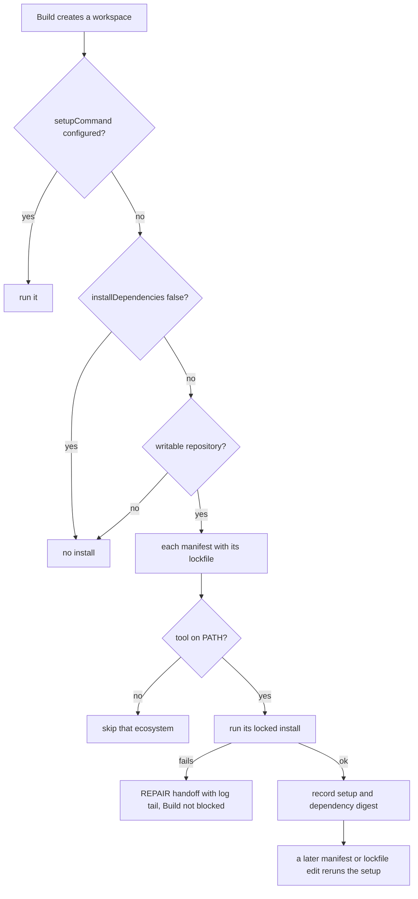

# Design

## Work type

feature

## เส้นทางผู้ใช้

How Build prepares a workspace's dependencies without a configured setup command



## ตารางความล้มเหลว

| Failure | User sees | Recovery | Covers |
|---|---|---|---|
| retry | รันคำสั่งเดิมอีกครั้ง | No separate step; the outcome is the handling | sibling-repository-install |

## แผนที่ไฟล์

| Tasks | Paths |
|---|---|
| T001 | `.claude/harness/runtime/workflow/sandbox/sandbox-setup.mjs`, `.claude/harness/lifecycle/build.md`, `.claude/tests/run-all.sh`, `.claude/tests/README.md` |
| T001; T002 | `.claude/harness/tests/sandbox-polyglot-setup.test.mjs` (add), `.claude/harness/README.md`, `CHANGELOG.md` |
| T002 | `.claude/harness/runtime/workflow/sandbox/sandbox-repositories.mjs` |

`+` add · `~` change · `-` remove

```text
.
├── .claude/
│   ├── harness/
│   │   ├── lifecycle/
│   │   │   └── ~ build.md
│   │   ├── ~ README.md
│   │   ├── runtime/
│   │   │   └── workflow/
│   │   │       └── sandbox/
│   │   │           ├── ~ sandbox-repositories.mjs
│   │   │           └── ~ sandbox-setup.mjs
│   │   └── tests/
│   │       └── + sandbox-polyglot-setup.test.mjs
│   └── tests/
│       ├── ~ README.md
│       └── ~ run-all.sh
└── ~ CHANGELOG.md
```

## แผนที่ test

| Scenario | Level | Check | Task |
|---|---|---|---|
| PHP; สองภาษา; Flutter; ไม่มีเครื่องมือ; manifest ไม่มี lockfile; ปิดการติดตั้ง; lockfile เปลี่ยน | task check | `node --test .claude/harness/tests/sandbox-polyglot-setup.test.mjs` | T001 |
| repo ลูก JS; repo อ่านอย่างเดียว; retry | task check | `node --test .claude/harness/tests/sandbox-polyglot-setup.test.mjs` | T002 |
