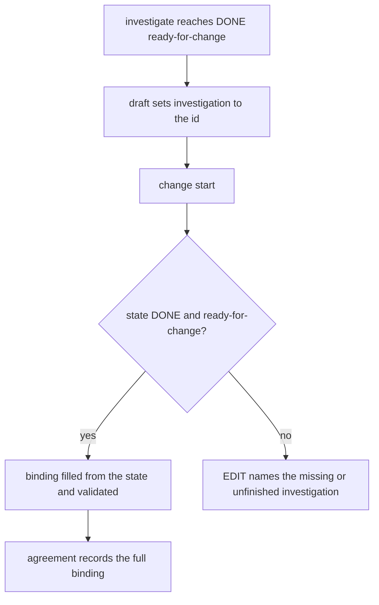

# Change: draft ผูก investigation ได้ด้วย id อย่างเดียวโดยระบบเติม binding จาก state ปัจจุบันให้ และข้อความแก้ binding บอกวิธีนี้

- **Change:** `investigation-bind-by-id` · **Lane:** rapid (low risk)
- **Review:** not required · **Owner:** unassigned · **Created:** 2026-11-28

## สรุป

agent ส่งผลการสำรวจต่อเข้าข้อตกลงได้ด้วยชื่อการสำรวจอย่างเดียว ระบบเติมรายละเอียดที่เหลือให้เอง

## เหตุผล

[Data] ตอนนำผลสำรวจการรองรับหลายภาษาเข้าข้อตกลง agent คัดลอกข้อมูลผูกมาไม่ครบ ระบบตอบกลับสามข้อว่าข้อมูลไม่ตรง จนต้องตัดการผูกทิ้งและข้อตกลงไม่ได้อ้างผลสำรวจ ทั้งที่ระบบมีข้อมูลครบอยู่แล้วในสถานะของการสำรวจ

## ขอบเขต

- **อยู่ในขอบเขต (`investigation-intake`):** agent ผูก investigation ได้ในรอบเดียว
- **นอกขอบเขต:** สิ่งที่ไม่ทำ (Non-goals) ด้านล่าง

## Non-goals

- ผูก investigation ที่ยังไม่ DONE
- เปลี่ยนรูปแบบ binding เต็มที่ใช้อยู่ (ยังรับเหมือนเดิม)

## ผลกระทบและความเสี่ยง

ความเสี่ยงต่ำ: แก้เฉพาะจุด ไม่กระทบส่วนอื่น

- **Impact:** low
- **Coupling:** isolated

## การสื่อสาร การดูแลหลังปล่อย และ release note

### Release note

A draft can bind its investigation as `"investigation": "<id>"` (or `{ "id": "<id>" }`); the harness fills the version-2 binding from that investigation's current state, so the agent no longer copies the handoff by hand. Binding repairs name this form.

## รายละเอียดทางเทคนิค

ส่วนนี้สำหรับนักพัฒนาและผู้รีวิว: ไฟล์ที่แตะ, การวิเคราะห์ทางเทคนิค, เกณฑ์ผ่าน และนิยามของงานเสร็จ

### ไฟล์และ repository

- **นอกขอบเขต:** การแก้นอกไฟล์ `.claude/harness/runtime/workflow/investigation/investigation-runtime.mjs`, `.claude/harness/runtime/workflow/change/change-lifecycle.mjs`, `.claude/harness/runtime/workflow/validation/investigation-coverage.mjs`, `.claude/harness/tests/investigation-bind-by-id.test.mjs`, `.claude/skills/investigate/references/workflow.md`, `.claude/harness/lifecycle/investigate.md`, … +3 more

## User flow

How an agent hands a finished investigation to Change

## Work type

feature

## Failure matrix

| Failure | User sees | Recovery | Covers |
|---|---|---|---|
| ยังไม่เสร็จ | validation รายงานว่าต้องเป็น ready-for-change DONE state | No separate step; the outcome is the handling | investigation-binding-by-id |

## เกณฑ์ผ่าน

Task: `tasks.md`; scenario: ใน specs

| Requirement | Scenario | ชนิด | Task | Check | Decision |
|---|---|---|---|---|---|
| investigation-binding-by-id | ผูกด้วย id | success | T001 | test: `.claude/harness/tests/investigation-bind-by-id.test.mjs`, `.claude/tests/run-all.sh` | — |
|  | object มีแค่ id | success | T001 |  |  |
|  | binding เต็มเดิม | boundary | T001 |  |  |
|  | ยังไม่เสร็จ | failure | T001 |  |  |

## นิยามของงานเสร็จ

- Fresh evidence for every claim (4).
- Changed tests fail on the original code.
- Review: not required (rapid lane, low tier: deterministic evidence only).
- Land archives it; Land never commits.
- Success: acceptance scenarios above pass.
