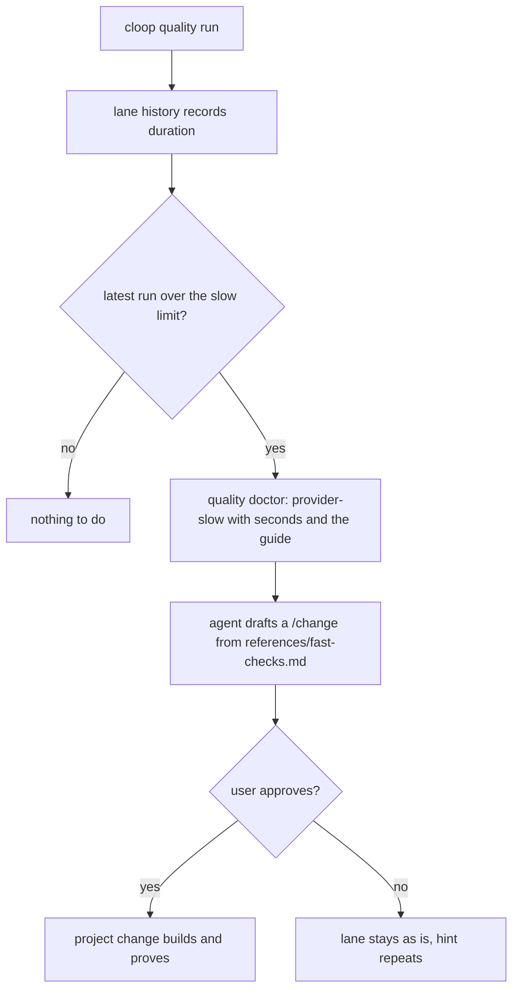

# Change: onboard สอน agent ให้ตั้งเทสต์และเครื่องมือตรวจของโปรเจกต์ให้รันเร็ว และ quality doctor ชี้ lane ที่ช้าพร้อมวิธีแก้จากคู่มือ

- **Change:** `onboard-agent-quality-doctor-lane` · **Lane:** rapid (low risk)
- **Review:** not required · **Owner:** unassigned · **Created:** 2026-11-28

## สรุป

onboard จะสอน agent ให้ทำเทสต์และเครื่องมือตรวจของโปรเจกต์ให้รันเร็ว และชี้ lane ที่ช้าพร้อมวิธีแก้

## เหตุผล

[Data] onboard ตอนนี้ตรวจและเตือนเรื่องความเร็ว (readiness tests-fast, ตัวจับเทสต์ค้าง, doctor เสนอ paths) แต่คู่มือมีแค่ประโยคเดียวใน references/verify.md ว่าให้ทำ verify สั้นและเร็ว ไม่ได้บอกวิธี

[Data] log ของ repo ผู้ใช้แสดงว่าเวลาส่วนใหญ่ของ harness หมดไปกับการรันเทสต์ เช่น lane mutation 4.5 นาทีต่อ Prove และเทสต์ที่ค้าง 6 นาทีต่อรอบ

[Data] เจ้าของโปรเจกต์กำหนดว่า Change Loop ต้องไม่ถ่วงเวลางาน และให้ช่วยแนะนำผู้ใช้ตอนนำไปใช้ โดยไม่แก้ repo ของผู้ใช้เอง

## ขอบเขต

- **อยู่ในขอบเขต (`quality-tooling`):** agent มีแนวทางเดียวกันในการทำให้รอบแก้-เทสต์เร็ว; lane ที่ช้าถูกชี้ตั้งแต่ onboard
- **นอกขอบเขต:** สิ่งที่ไม่ทำ (Non-goals) ด้านล่าง

## Non-goals

- แก้เทสต์หรือ script ของโปรเจกต์ผู้ใช้อัตโนมัติ
- เปลี่ยนเกณฑ์ readiness tests-fast

## ผลกระทบและความเสี่ยง

ความเสี่ยงต่ำ: แก้เฉพาะจุด ไม่กระทบส่วนอื่น

- **Impact:** low
- **Coupling:** isolated

## การสื่อสาร การดูแลหลังปล่อย และ release note

### Release note

Onboarding now carries a fast-checks guide (split fast and full suites, per-task verify, close test resources, parallel runs and caches, fast linters, readable output) for every language a toolchain pack covers, and quality doctor names each lane whose latest run was slow with the guide's fix.

## รายละเอียดทางเทคนิค

ส่วนนี้สำหรับนักพัฒนาและผู้รีวิว: ไฟล์ที่แตะ, การวิเคราะห์ทางเทคนิค, เกณฑ์ผ่าน และนิยามของงานเสร็จ

### ไฟล์และ repository

- **นอกขอบเขต:** การแก้นอกไฟล์ `.claude/skills/onboard/references/fast-checks.md`, `.claude/skills/onboard/SKILL.md`, `.claude/tests/docs/skill-catalog.test.mjs`, `.claude/harness/runtime/quality/quality-doctor-hints.mjs`, `.claude/harness/runtime/quality/quality-runtime.mjs`, `.claude/harness/tests/quality-runtime.test.mjs`, … +2 more

## User flow

How onboarding turns a slow lane into a proposed fix

## Work type

feature

## Failure matrix

| Failure | User sees | Recovery | Covers |
|---|---|---|---|
| test lane ช้า | มี provider-slow ที่บอก 300s และชี้ fast-checks | No separate step; the outcome is the handling | slow-lane-hint |

## Test map

| Scenario | Level | File | Task |
|---|---|---|---|
| fast-checks-guide-claude-skills-onboard-references-fast-checks-m | — | .claude/tests/docs/skill-catalog.test.mjs | — |
| fast-checks-guide-claude-skills-onboard-skill-md | — | .claude/tests/docs/skill-catalog.test.mjs | — |

## เกณฑ์ผ่าน

Task: `tasks.md`; scenario: ใน specs

| Requirement | Scenario | ชนิด | Task | Check | Decision |
|---|---|---|---|---|---|
| fast-checks-guide | คู่มือมีครบ | success | T001 | test: `.claude/tests/docs/skill-catalog.test.mjs` | — |
|  | skill อ้างถึงคู่มือ | success | T001 |  |  |
| slow-lane-hint | lane เร็ว | boundary | T002 | test: `.claude/harness/tests/quality-runtime.test.mjs` | — |
|  | ยังไม่เคยรัน | boundary | T002 |  |  |
|  | test lane ช้า | failure | T002 |  |  |

## นิยามของงานเสร็จ

- Fresh evidence for every claim (5).
- Changed tests fail on the original code.
- Review: not required (rapid lane, low tier: deterministic evidence only).
- Land archives it; Land never commits.
- Success: acceptance scenarios above pass.
