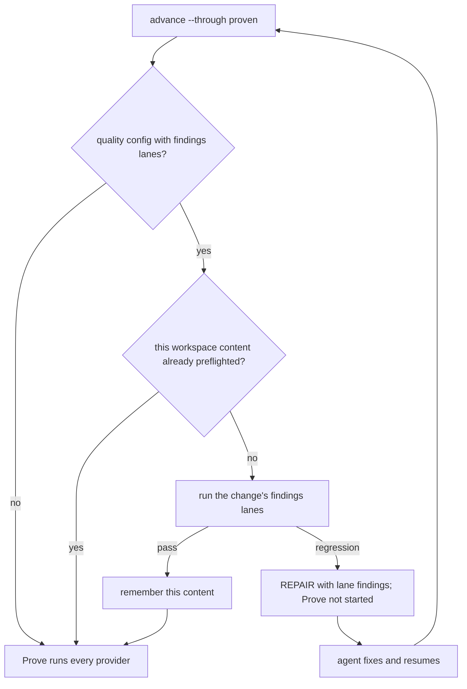

# Design

## Work type

feature

## เส้นทางผู้ใช้

How an agent learns about a cheap regression before the full Prove run



## ตารางความล้มเหลว

| Failure | User sees | Recovery | Covers |
|---|---|---|---|
| ไฟล์โตเกิน ratchet | ได้ REPAIR ที่ระบุ file-size และ Prove ไม่เริ่ม | No separate step; the outcome is the handling | findings-preflight |

## แผนที่ไฟล์

| Tasks | Paths |
|---|---|
| T001 | `.claude/harness/runtime/quality/quality-preflight.mjs` (add), `.claude/harness/runtime/composition/delivery-wiring.mjs`, `.claude/harness/runtime/composition/lifecycle-wiring.mjs`, `.claude/harness/foundation.mjs`, `.claude/harness/lifecycle/prove.md`, `.claude/tests/run-all.sh`, `.claude/tests/README.md` |
| T001; T002 | `.claude/harness/tests/quality-preflight.test.mjs` (add), `.claude/harness/CONSUMER-QUALITY.md`, `CHANGELOG.md` |
| T002 | `.claude/harness/runtime/quality/quality-runtime.mjs` |

`+` add · `~` change · `-` remove

```text
.
├── .claude/
│   ├── harness/
│   │   ├── ~ CONSUMER-QUALITY.md
│   │   ├── ~ foundation.mjs
│   │   ├── lifecycle/
│   │   │   └── ~ prove.md
│   │   ├── runtime/
│   │   │   ├── composition/
│   │   │   │   ├── ~ delivery-wiring.mjs
│   │   │   │   └── ~ lifecycle-wiring.mjs
│   │   │   └── quality/
│   │   │       ├── + quality-preflight.mjs
│   │   │       └── ~ quality-runtime.mjs
│   │   └── tests/
│   │       └── + quality-preflight.test.mjs
│   └── tests/
│       ├── ~ README.md
│       └── ~ run-all.sh
└── ~ CHANGELOG.md
```

## แผนที่ test

| Scenario | Level | Check | Task |
|---|---|---|---|
| ไฟล์โตเกิน ratchet; ผ่านแล้วเข้า Prove; เนื้อหาเดิม; ไม่มี quality config | task check | `node --test .claude/harness/tests/quality-preflight.test.mjs` | T001 |
| มี change; ไม่มี change | task check | `node --test .claude/harness/tests/quality-preflight.test.mjs` | T002 |
