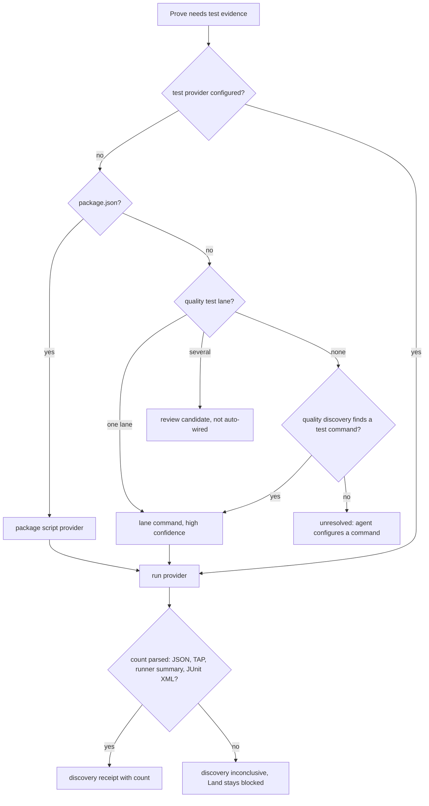

# Design

## Work type

feature

## เส้นทางผู้ใช้

How a non-JavaScript repository reaches a counted test receipt in Prove



## ตารางความล้มเหลว

| Failure | User sees | Recovery | Covers |
|---|---|---|---|
| go build error | ผลเป็น fail ไม่ใช่ pass | No separate step; the outcome is the handling | runner-summary-counts |
| attribute ไม่ใช่ตัวเลข | ไม่นับ | No separate step; the outcome is the handling | junit-xml-counts |
| ไม่พบ | ได้ unresolved no-safe-project-command | No separate step; the outcome is the handling | test-provider-without-package-json |
| verify ไฟล์ที่ไม่มี | ได้ issue ว่าไฟล์ไม่มีอยู่ | No separate step; the outcome is the handling | polyglot-path-kinds |

## แผนที่ไฟล์

| Tasks | Paths |
|---|---|
| T001 | `.claude/harness/runtime/evidence/runner-summaries.mjs` (add), `.claude/harness/runtime/evidence/adapter-runtime.mjs`, `.claude/harness/tests/runner-summaries.test.mjs` (add), `.claude/harness/tests/change-atomic-start.test.mjs` |
| T001; T003 | `.claude/harness/runtime/workflow/validation/design-blueprints.mjs`, `.claude/tests/run-all.sh` |
| T001; T002 | `.claude/harness/EVIDENCE.md` |
| T001; T002; T003 | `CHANGELOG.md` |
| T002 | `.claude/harness/runtime/evidence/evidence-bootstrap.mjs`, `.claude/harness/tests/evidence-bootstrap.test.mjs` |
| T003 | `.claude/harness/runtime/workflow/validation/dev-document.mjs`, `.claude/harness/runtime/workflow/draft/amendment-verify.mjs`, `.claude/harness/tests/polyglot-path-kinds.test.mjs` (add) |

`+` add · `~` change · `-` remove

```text
.
├── .claude/
│   ├── harness/
│   │   ├── ~ EVIDENCE.md
│   │   ├── runtime/
│   │   │   ├── evidence/
│   │   │   │   ├── ~ adapter-runtime.mjs
│   │   │   │   ├── ~ evidence-bootstrap.mjs
│   │   │   │   └── + runner-summaries.mjs
│   │   │   └── workflow/
│   │   │       ├── draft/
│   │   │       │   └── ~ amendment-verify.mjs
│   │   │       └── validation/
│   │   │           ├── ~ design-blueprints.mjs
│   │   │           └── ~ dev-document.mjs
│   │   └── tests/
│   │       ├── ~ change-atomic-start.test.mjs
│   │       ├── ~ evidence-bootstrap.test.mjs
│   │       ├── + polyglot-path-kinds.test.mjs
│   │       └── + runner-summaries.test.mjs
│   └── tests/
│       └── ~ run-all.sh
└── ~ CHANGELOG.md
```

## แผนที่ test

| Scenario | Level | Check | Task |
|---|---|---|---|
| pytest; cargo หลาย crate; Maven; PHPUnit; dotnet; Dart; Swift; ExUnit; RSpec และ Minitest; go test -v; go build error; ไม่มีบรรทัดสรุป; parser เดิมมาก่อน; testsuites; หลาย testsuite; ไฟล์เก่า; attribute ไม่ใช่ตัวเลข | task check | `node --test .claude/harness/tests/runner-summaries.test.mjs` | T001 |
| จาก quality lane; จาก discovery; หลาย lane; ไม่พบ | task check | `node --test .claude/harness/tests/evidence-bootstrap.test.mjs` | T002 |
| เทสต์ JVM; .NET; manifest; คำที่ไม่ใช่เทสต์; verify ไฟล์ที่ไม่มี | task check | `node --test .claude/harness/tests/polyglot-path-kinds.test.mjs` | T003 |
