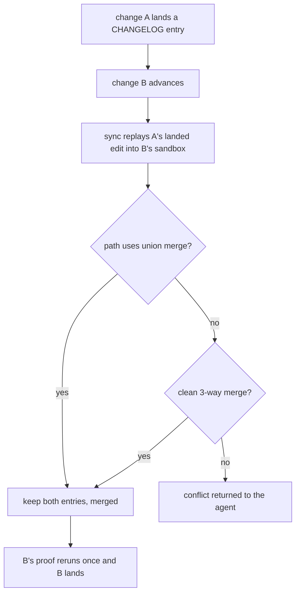

# Change: การ sync งานที่ land แล้วรวม CHANGELOG แบบเก็บทั้งสองฝั่งโดยไม่ชน และ change ที่ intent เป็นภาษาอื่นนอกจากอังกฤษได้ชื่อจากโฟลเดอร์ draft

- **Change:** `sync-land-changelog-change-intent-draft` · **Lane:** rapid (low risk)
- **Review:** not required · **Owner:** unassigned · **Created:** 2026-11-28

## สรุป

change ที่ทำต่อกันไม่ต้องหยุดแก้ไฟล์บันทึกการเปลี่ยนแปลงที่ชนกันตอนนำงานเข้า และชื่อ change อ่านออกเมื่อเขียนความต้องการเป็นภาษาไทย

## เหตุผล

[Data] ตอนนำ change ที่สองของงานรองรับหลายภาษาเข้า ไฟล์บันทึกการเปลี่ยนแปลงชนกับ change แรก agent ต้องรวมเองและขั้นพิสูจน์ต้องรันใหม่อีกสองรอบ เสียเวลาราวห้านาที ทั้งที่ทั้งสองฝั่งแค่เพิ่มรายการคนละบรรทัด

[Data] ชื่อ change ที่สร้างจากความต้องการภาษาไทยเหลือแต่คำอังกฤษที่ปนอยู่ เช่น test-lane-repo-mutation-suite-suite-suite-mutation-suite-automat ทำให้อ่านและอ้างถึงยาก

## ขอบเขต

- **อยู่ในขอบเขต:** change ที่เพิ่ม CHANGELOG ต่อกันไม่หยุดที่ sync conflict; ชื่อ change อ่านออกเมื่อเขียน intent เป็นภาษาไทย
- **นอกขอบเขต:** สิ่งที่ไม่ทำ (Non-goals) ด้านล่าง

## Non-goals

- union merge ไฟล์อื่นนอกจากที่ .gitattributes ระบุ merge=union และไฟล์ changelog
- เปลี่ยนชื่อ change ที่มีอยู่แล้ว หรือชื่อของ draft ที่ intent เป็นภาษาอังกฤษล้วน

## ผลกระทบและความเสี่ยง

ความเสี่ยงต่ำ: แก้เฉพาะจุด ไม่กระทบส่วนอื่น

- **Impact:** low
- **Coupling:** isolated

## การสื่อสาร การดูแลหลังปล่อย และ release note

### Release note

Replaying another change's landed edit merges files marked `merge=union` in `.gitattributes`, and changelog files (`CHANGELOG*.md`, `CHANGES.md`) without a merge attribute, by keeping both sides, so two changes that each add a changelog entry no longer stop at a sync conflict. A draft whose intent is not plain English (for example Thai) is named after its draft folder or file instead of the few ASCII words left in its intent.

## รายละเอียดทางเทคนิค

ส่วนนี้สำหรับนักพัฒนาและผู้รีวิว: ไฟล์ที่แตะ, การวิเคราะห์ทางเทคนิค, เกณฑ์ผ่าน และนิยามของงานเสร็จ

### ไฟล์และ repository

- **นอกขอบเขต:** การแก้นอกไฟล์ `.claude/harness/runtime/workflow/transaction/target-edits.mjs`, `.claude/harness/tests/landed-union-merge.test.mjs`, `.claude/harness/lifecycle/land.md`, `.claude/tests/run-all.sh`, `.claude/tests/README.md`, `.gitattributes`, … +4 more

## User flow

How a second change that edited the changelog reaches Land after the first one landed

## Work type

feature

## Failure matrix

| Failure | User sees | Recovery | Covers |
|---|---|---|---|
| ไฟล์โค้ดชนยังเป็น conflict | ได้ conflict เหมือนเดิม | No separate step; the outcome is the handling | union-merge-landed-replay |

## Capability ที่เปลี่ยน

| Capability | Requirements | Tasks |
|---|---|---|
| land-target-carry | union-merge-landed-replay | T001 |
| change | change-id-from-draft-name | T002 |

## เกณฑ์ผ่าน

Task: `tasks.md`; scenario: ใน specs

| Requirement | Scenario | ชนิด | Task | Check | Decision |
|---|---|---|---|---|---|
| union-merge-landed-replay | CHANGELOG สองรายการ | success | T001 | test: `.claude/harness/tests/landed-union-merge.test.mjs`, `.claude/tests/run-all.sh` | — |
|  | gitattributes union | success | T001 |  |  |
|  | ปิด union ด้วย attribute | boundary | T001 |  |  |
|  | ไฟล์โค้ดชนยังเป็น conflict | failure | T001 |  |  |
| change-id-from-draft-name | intent ไทยปนอังกฤษ | success | T002 | test: `.claude/harness/tests/change-id-from-draft.test.mjs`, `.claude/tests/run-all.sh` | — |
|  | intent อังกฤษ | boundary | T002 |  |  |
|  | ชื่อ draft ทั่วไป | boundary | T002 |  |  |
|  | id ระบุเอง | boundary | T002 |  |  |

## นิยามของงานเสร็จ

- Fresh evidence for every claim (8).
- Changed tests fail on the original code.
- Review: not required (rapid lane, low tier: deterministic evidence only).
- Land archives it; Land never commits.
- Success: acceptance scenarios above pass.

## Appendix: Amendment history

- Revision 1 (2026-11-28): Agreement expanded during Build
