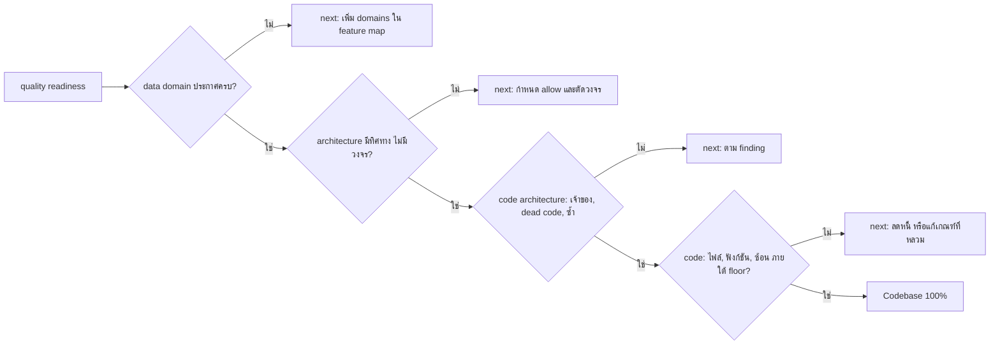

# Design

## สถานะปัจจุบัน

pyramid-readiness.mjs นับ lane codebase เป็น met เมื่อ ratcheting และ clear เมื่อ findings เป็น 0 ไม่มีการอ่านค่าเพดาน; code-health-findings.mjs สแกนวงเล็บ/ย่อหน้าระดับไฟล์และหาโค้ดซ้ำแบบ Type-1; module-boundaries รองรับ JS/TS และร่างจาก onboard อนุญาตทุกทิศที่มี; feature map ไม่มี domain และไม่ตรวจความครอบคลุมไฟล์; repo นี้ตรวจแค่ runtime, adapters และ hooks

## สมมติฐาน

- references หลายตัวที่ชี้ pattern เดียวกันไม่มีลำดับ (no tie on sort key): ทุกตัวต้องสะอาด และ agent ใช้ตัวแรกตามลำดับที่ประกาศเป็นค่า default แบบ stable
- ไฟล์ว่าง (empty) ฟังก์ชันว่าง หรือไฟล์ที่มีแต่ whitespace ไม่ให้ finding ใน function-size, cognitive-complexity และ duplication
- baseline หรือ provider config ที่ corrupt, missing หรือเป็น older shape: lane ใช้กติกาเดิมของ findings ratchet (no-baseline หรือ incompatible พร้อม next ให้ตั้ง baseline ใหม่) และ readiness ไม่นับเป็น met; เพดานที่ไม่ได้ตั้งใช้ default เท่ากับ floor
- dead-code ข้ามไฟล์ที่ size เกิน 512 KiB หรือ minified (exceeds limit) เหมือน lane ในตัวเดิม
- domains ที่มี unknown field หรือ empty paths เป็น issue ของ feature map ไม่รองรับเป็น lane error

## Work type

feature

## สถาปัตยกรรม

lane ใหม่ทุกตัวเป็น builtin ของ findings-ratchet ใช้ baseline และ ratchet เดิม แต่ละตัวอยู่ในโมดูลของตัวเองใต้ runtime/quality (data-domains, import-graph, feature-ownership, function-metrics, dead-code) และใช้ source-scan ร่วมกัน readiness อ่าน provider config เพื่อเทียบ floor และติด sublayer ให้แต่ละเกณฑ์

## เส้นทางผู้ใช้

agent ดูคะแนนชั้น Codebase แล้วแก้ตามลำดับ



## Decisions

- **Decision ID:** DEC-001
  - **Status:** accepted
  - **Decision:** ตัววัดในตัวใช้การแยก token/วงเล็บ/ย่อหน้า ไม่ใช่ parser; ถ้าโปรเจกต์มี knip, vulture หรือ eslint complexity อยู่แล้วให้ adapter อ่านผลเครื่องมือแทน
  - **Why:** ผู้ใช้เลือกทุกภาษาแบบประมาณ + ใช้เครื่องมือถ้ามี; ไม่เพิ่ม dependency
  - **Rejected:** none
  - **Consequences:** อาจมี false positive หรือ negative ในภาษาที่ไวยากรณ์ซับซ้อน; baseline ดูดซับของเดิม
- **Decision ID:** DEC-002
  - **Status:** accepted
  - **Decision:** floor อยู่ใน quality policy ของ Change Loop: ไฟล์ 1000, ฟังก์ชัน 80, cognitive 15, nesting 5, duplication window 8, วงจร 0; โปรเจกต์ตั้งเข้มกว่าได้ หลวมกว่าทำให้ข้อนั้น unmet
  - **Why:** ผู้ใช้เลือกชุดมาตรฐาน; ตัวเลขฟังก์ชันเป็นค่าตั้งต้นตามแนวปฏิบัติ ไม่มีงานวิจัยยืนยันเลขเดียว
  - **Rejected:** none
  - **Consequences:** โปรเจกต์ที่ตั้งเพดานหลวมจะเห็นคะแนน Codebase ลดจนกว่าจะลดเพดาน
- **Decision ID:** DEC-003
  - **Status:** accepted
  - **Decision:** domains อยู่ใน openspec/feature-map.json ฟีเจอร์อ้าง domain ของตัวเอง
  - **Why:** ผู้ใช้เลือก; agent อ่านไฟล์เดียวเห็น feature → domain → โค้ด → ข้อมูล
  - **Rejected:** none
  - **Consequences:** schema ของ feature map เพิ่ม domains แบบไม่บังคับ; map เดิมยังใช้ได้
- **Decision ID:** DEC-SCOPE
  - **Status:** accepted
  - **Context:** งานครอบคลุมอะไร
  - **Decision:** ครบ 5 ข้อ + data domain + architecture + code architecture
  - **Why:** No alternative was open; recorded as settled
  - **Rejected:** none
  - **Consequences:** Not stated in the draft
  - **Decided by:** user
- **Decision ID:** DEC-DESIGN
  - **Status:** accepted
  - **Context:** data domain, ภาษา, floor, การบังคับ
  - **Decision:** feature map; ทุกภาษาแบบประมาณ + เครื่องมือถ้ามี; ชุดมาตรฐาน; ratchet
  - **Why:** No alternative was open; recorded as settled
  - **Rejected:** none
  - **Consequences:** Not stated in the draft
  - **Decided by:** user
- **Decision ID:** DEC-PLAYBOOK-ADDITIONS
  - **Status:** accepted
  - **Context:** เพิ่มเรื่องจาก Engineering Playbook ชั้น Codebase ข้อใด
  - **Decision:** ครบ 4 ข้อ: domain invariants, API contract, reference implementation, shared SDK
  - **Why:** No alternative was open; recorded as settled
  - **Rejected:** none
  - **Consequences:** Not stated in the draft
  - **Decided by:** user

## ตารางความล้มเหลว

| Failure | User sees | Recovery | Covers |
|---|---|---|---|
| เพดานหลวมกว่า floor | ข้อ file-size เป็น unmet | No separate step; the outcome is the handling | codebase-floors |
| duplication window กว้างกว่า floor | ข้อ duplication เป็น unmet | No separate step; the outcome is the handling | codebase-floors |
| import ส่วนภายใน | มี finding domain/private-import ที่ src/billing/x.ts | No separate step; the outcome is the handling | data-domains |
| อ้างตารางของ domain อื่น | มี finding domain/foreign-data ที่ src/billing/x.ts | No separate step; the outcome is the handling | data-domains |
| ข้อมูลมีสองเจ้าของ | มี issue ข้อมูลซ้ำเจ้าของ | No separate step; the outcome is the handling | data-domains |
| โมดูลวนกัน | มี finding วงจร a-b หนึ่งรายการ | No separate step; the outcome is the handling | directed-architecture |
| allow ทุกทิศ | ข้อ module-boundaries เป็น unmet ด้วยเหตุไม่มีทิศทาง | No separate step; the outcome is the handling | directed-architecture |
| ไฟล์ไม่มีเจ้าของ | มี finding feature/unowned ที่ src/b/x.ts | No separate step; the outcome is the handling | feature-ownership |
| ฟังก์ชันยาว | มี finding function/size ที่ชื่อฟังก์ชันนั้น value 81 | No separate step; the outcome is the handling | function-metrics |
| ซับซ้อนเกิน | มี finding function/cognitive value 16 | No separate step; the outcome is the handling | function-metrics |
| ไฟล์ไม่มีใครใช้ | มี finding dead/file ที่ src/old.ts | No separate step; the outcome is the handling | dead-code |
| เปลี่ยนชื่อตัวแปร | มี finding duplication/block หนึ่งรายการ | No separate step; the outcome is the handling | type2-duplication |
| ไฟล์ใน scripts โตเกิน | lane file-size ของ repo นี้รายงาน regression | No separate step; the outcome is the handling | repository-scope |
| ใส่วงจร | เฉพาะ import-cycles เป็น unmet | No separate step; the outcome is the handling | golden-fixture |
| ใส่ไฟล์ไม่มีเจ้าของ | feature-ownership และ dead-code เป็น unmet เท่านั้น | No separate step; the outcome is the handling | golden-fixture |
| กฎไม่มีเทสต์ | มี finding domain/invariant-untested ที่ invariant นั้น | No separate step; the outcome is the handling | domain-invariants |
| เทสต์ที่อ้างไม่มีอยู่ | มี finding domain/invariant-missing-test | No separate step; the outcome is the handling | domain-invariants |
| ไม่มีสัญญา | มี finding domain/no-contract | No separate step; the outcome is the handling | api-contracts |
| สัญญาชี้ไฟล์หาย | มี finding domain/missing-contract | No separate step; the outcome is the handling | api-contracts |
| reference มีหนี้ | มี finding reference/unclean ที่อ้าง rule ของหนี้นั้น | No separate step; the outcome is the handling | reference-implementations |
| reference หาย | มี finding reference/missing | No separate step; the outcome is the handling | reference-implementations |
| เรียก driver ตรง | มี finding sdk/bypass ที่บอก reason และให้ใช้ payments | No separate step; the outcome is the handling | shared-sdk |
| Go import ตรง | มี finding sdk/bypass | No separate step; the outcome is the handling | shared-sdk |

## ความเข้ากันได้และการปล่อย

lane ใหม่ไม่ถูกเปิดอัตโนมัติใน config ที่มีอยู่: readiness แสดงเป็น no-lane พร้อม next ให้ onboard เพิ่ม; Type-2 duplication อาจเพิ่ม findings ใน baseline เดิม readiness บอกให้ตั้ง baseline ใหม่พร้อมเหตุผล; ถ้า protocol ของ readiness เปลี่ยนรูปแบบ ให้ขยับ pin ใน protocol.json พร้อม upgrade coverage

## กลยุทธ์การทดสอบ

unit test ต่อโมดูลด้วย fixture เล็ก, golden fixture ที่ใส่ข้อบกพร่องทีละข้อ แล้วเช็กว่าเกณฑ์อื่นไม่เปลี่ยน, และ default gate ของ repo

## แผนที่ไฟล์

| Tasks | Paths |
|---|---|
| T001 | `.claude/harness/runtime/quality/pyramid-readiness.mjs`, `.claude/harness/runtime/quality/quality-policy.mjs`, `.claude/harness/runtime/composition/pyramid-readiness-command.mjs`, `.claude/harness/tests/pyramid-readiness.test.mjs`, `.claude/harness/tests/codebase-floors.test.mjs` (add) |
| T002; T009 | `.claude/harness/runtime/workflow/validation/project-feature-map.mjs` |
| T002 | `.claude/harness/runtime/quality/data-domains.mjs` (add), `.claude/harness/tests/data-domains.test.mjs` (add) |
| T002; T003; T004; T005; T006; T009; T010; T011 | `.claude/harness/runtime/quality/findings-ratchet.mjs` |
| T003 | `.claude/harness/runtime/quality/import-graph.mjs` (add), `.claude/harness/runtime/quality/module-boundary-proposal.mjs`, `.claude/harness/tests/import-graph.test.mjs` (add) |
| T004 | `.claude/harness/runtime/quality/feature-ownership.mjs` (add), `.claude/harness/tests/feature-ownership.test.mjs` (add) |
| T005 | `.claude/harness/runtime/quality/function-metrics.mjs` (add), `.claude/harness/tests/function-metrics.test.mjs` (add) |
| T006 | `.claude/harness/runtime/quality/dead-code.mjs` (add), `.claude/harness/tests/dead-code.test.mjs` (add) |
| T007 | `.claude/harness/runtime/quality/code-health-findings.mjs`, `.claude/harness/tests/code-health-findings.test.mjs` (add), `.claude/harness/tests/type2-duplication.test.mjs` (add) |
| T008 | `.claude/harness/runtime/quality/quality-discovery.mjs`, `.claude/harness/runtime/quality/toolchain-packs.json`, `.claude/skills/onboard/`, `.claude/harness/tests/codebase-discovery.test.mjs` (add) |
| T009 | `.claude/harness/runtime/quality/domain-declarations.mjs` (add), `.claude/harness/tests/domain-declarations.test.mjs` (add) |
| T010 | `.claude/harness/runtime/quality/reference-implementations.mjs` (add), `.claude/harness/tests/reference-implementations.test.mjs` (add) |
| T011 | `.claude/harness/runtime/quality/shared-sdk.mjs` (add), `.claude/harness/tests/shared-sdk.test.mjs` (add) |
| T012 | `.claude/harness/tests/fixtures/codebase-golden/` (add), `.claude/harness/tests/codebase-golden.test.mjs` (add) |
| T013 | `scripts/quality/test/repository-findings.test.mjs`, `scripts/quality/test/scorecard.test.mjs`, `scripts/quality/`, `scripts/lint/`, `quality/`, `openspec/feature-map.json` |
| T014 | `docs/feature-map.md`, `docs/feature-map.json`, `website/docs/src/content/docs/consumer-quality.md`, `website/docs/src/content/docs/th/consumer-quality.md`, `CHANGELOG.md` |

`+` add · `~` change · `-` remove

```text
.
├── .claude/
│   ├── harness/
│   │   ├── runtime/
│   │   │   ├── composition/
│   │   │   │   └── ~ pyramid-readiness-command.mjs
│   │   │   ├── quality/
│   │   │   │   ├── ~ code-health-findings.mjs
│   │   │   │   ├── + data-domains.mjs
│   │   │   │   ├── + dead-code.mjs
│   │   │   │   ├── + domain-declarations.mjs
│   │   │   │   ├── + feature-ownership.mjs
│   │   │   │   ├── ~ findings-ratchet.mjs
│   │   │   │   ├── + function-metrics.mjs
│   │   │   │   ├── + import-graph.mjs
│   │   │   │   ├── ~ module-boundary-proposal.mjs
│   │   │   │   ├── ~ pyramid-readiness.mjs
│   │   │   │   ├── ~ quality-discovery.mjs
│   │   │   │   ├── ~ quality-policy.mjs
│   │   │   │   ├── + reference-implementations.mjs
│   │   │   │   ├── + shared-sdk.mjs
│   │   │   │   └── ~ toolchain-packs.json
│   │   │   └── workflow/
│   │   │       └── validation/
│   │   │           └── ~ project-feature-map.mjs
│   │   └── tests/
│   │       ├── + code-health-findings.test.mjs
│   │       ├── + codebase-discovery.test.mjs
│   │       ├── + codebase-floors.test.mjs
│   │       ├── + codebase-golden.test.mjs
│   │       ├── + data-domains.test.mjs
│   │       ├── + dead-code.test.mjs
│   │       ├── + domain-declarations.test.mjs
│   │       ├── + feature-ownership.test.mjs
│   │       ├── fixtures/
│   │       │   └── + codebase-golden/
│   │       ├── + function-metrics.test.mjs
│   │       ├── + import-graph.test.mjs
│   │       ├── ~ pyramid-readiness.test.mjs
│   │       ├── + reference-implementations.test.mjs
│   │       ├── + shared-sdk.test.mjs
│   │       └── + type2-duplication.test.mjs
│   └── skills/
│       └── ~ onboard/
├── ~ CHANGELOG.md
├── docs/
│   ├── ~ feature-map.json
│   └── ~ feature-map.md
├── openspec/
│   └── ~ feature-map.json
├── ~ quality/
├── scripts/
│   ├── ~ lint/
│   └── ~ quality/
│       └── test/
│           ├── ~ repository-findings.test.mjs
│           └── ~ scorecard.test.mjs
└── website/
    └── docs/
        └── src/
            └── content/
                └── docs/
                    ├── ~ consumer-quality.md
                    └── th/
                        └── ~ consumer-quality.md
```

## แผนที่ test

| Scenario | Level | Check | Task |
|---|---|---|---|
| เพดานหลวมกว่า floor; เพดานเท่า floor; เพดานเข้มกว่า floor; duplication window กว้างกว่า floor; domain ยังไม่ผ่านแต่ไฟล์ใหญ่ด้วย; ข้อเทสต์ยังไม่ผ่าน | task check | `node --test .claude/harness/tests/codebase-floors.test.mjs .claude/harness/tests/pyramid-readiness.test.mjs` | T001 |
| import ผ่าน API; import ส่วนภายใน; อ้างตารางของ domain อื่น; ข้อมูลมีสองเจ้าของ; ไม่มี domains | task check | `node --test .claude/harness/tests/data-domains.test.mjs` | T002 |
| โมดูลวนกัน; วงจรใน Python; allow ทุกทิศ; ภาษาไม่รู้จัก | task check | `node --test .claude/harness/tests/import-graph.test.mjs` | T003 |
| ไฟล์ไม่มีเจ้าของ; ไฟล์เทสต์ | task check | `node --test .claude/harness/tests/feature-ownership.test.mjs` | T004 |
| ฟังก์ชันยาว; ยาวพอดีเกณฑ์; ซับซ้อนเกิน; object literal ไม่ใช่ฟังก์ชัน | task check | `node --test .claude/harness/tests/function-metrics.test.mjs` | T005 |
| ไฟล์ไม่มีใครใช้; entry point; ผลจาก knip | task check | `node --test .claude/harness/tests/dead-code.test.mjs` | T006 |
| เปลี่ยนชื่อตัวแปร; โครงสร้างต่าง | task check | `node --test .claude/harness/tests/type2-duplication.test.mjs` | T007 |
| มี knip ใน devDependencies; ไม่มีเครื่องมือ | task check | `node --test .claude/harness/tests/codebase-discovery.test.mjs` | T008 |
| กฎมีเทสต์; กฎไม่มีเทสต์; เทสต์ที่อ้างไม่มีอยู่; มี OpenAPI; ไม่มีสัญญา; สัญญาชี้ไฟล์หาย | task check | `node --test .claude/harness/tests/domain-declarations.test.mjs` | T009 |
| reference สะอาด; reference มีหนี้; reference หาย | task check | `node --test .claude/harness/tests/reference-implementations.test.mjs` | T010 |
| เรียกผ่าน SDK; เรียก driver ตรง; ภายใน SDK; Go import ตรง | task check | `node --test .claude/harness/tests/shared-sdk.test.mjs` | T011 |
| fixture สะอาด; ใส่วงจร; ใส่ไฟล์ไม่มีเจ้าของ | task check | `node --test .claude/harness/tests/codebase-golden.test.mjs` | T012 |
| ไฟล์ใน scripts โตเกิน; readiness ของ repo | task check | `node --test scripts/quality/test/repository-findings.test.mjs scripts/quality/test/scorecard.test.mjs` | T013 |
| domain ยังไม่ผ่านแต่ไฟล์ใหญ่ด้วย; ข้อเทสต์ยังไม่ผ่าน; import ผ่าน API; import ส่วนภายใน; อ้างตารางของ domain อื่น; ข้อมูลมีสองเจ้าของ; ไม่มี domains | task check | `bash .claude/tests/docs/run-doc-consistency.sh` | T014 |
